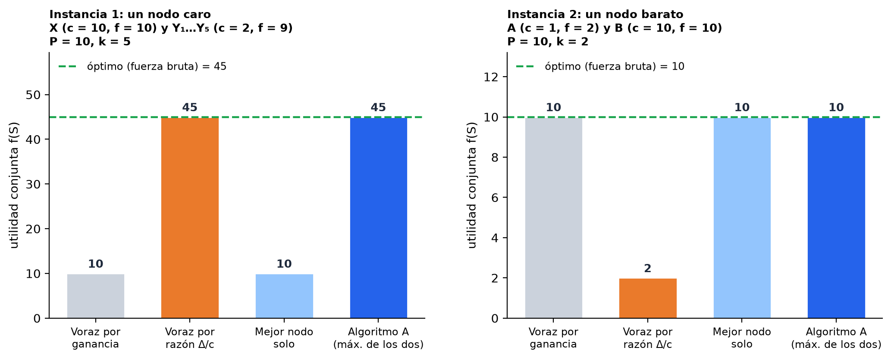
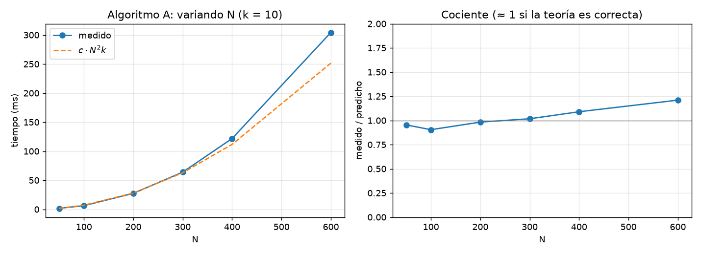
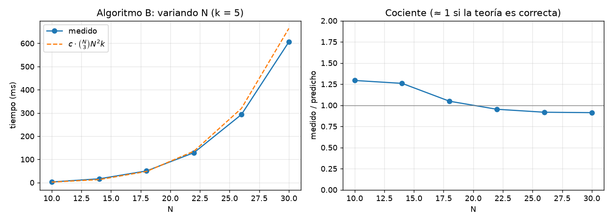
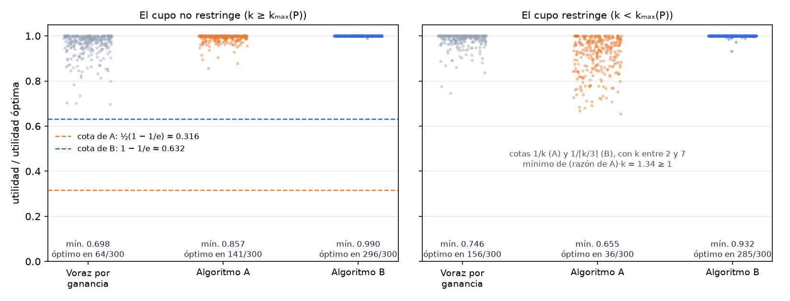

# Variantes del proyecto — Proyecto Red (Grupo 2)

Análisis y Diseño de Algoritmos · Universidad de Caldas · Entrega final

El enunciado (§4.4) pide tres variantes obligatorias. Este documento usa la misma notación del documento de formulación ([formulacion.md](formulacion.md)) y cita sus secciones por número: la utilidad de influencia f (Definición 2), la ganancia marginal Δᵢ(S) y su cálculo en O(N) (secciones 5.5 y 5.6), el Lema 4 (f es monótona, submodular y f(∅) = 0) y el Teorema 3 (cota 1 − 1/e del voraz con solo cupo k).

- **V1: costos de participación** (implementada; issue #11).
- **V2: rondas con fallas** (formalizada e implementada; evidencia experimental en esta sección y en `resultados/variantes/v2/`).
- **V3: nodos vecinos** (formalizada y analizada en esta sección, issue #14; implementación pendiente, issue #15).

Las figuras se generan con `python -m experimentos.figuras_variantes`.

---

## V1. Costos de participación

### V1.1 Planteamiento

En la Parte 2 cada nodo ocupa un lugar del cupo k, y todos los lugares valen lo mismo. En la variante V1 participar tiene un **costo** cᵢ distinto para cada nodo, y la ronda dispone de un **presupuesto de participación** P. El enunciado lo dice así: "versión con presupuesto de participación, no solo cupo k fijo", y agrega que la cota (1 − 1/e) "cambia de forma y debe redemostrarse o citarse en su versión correcta para cobertura con presupuesto (budgeted maximum coverage)".

Los casos de la profesora traen las dos restricciones a la vez: en el caso de 15 nodos, k = 5 y P = 24. Por eso planteamos la variante con **las dos restricciones** y separamos la teoría en dos regímenes, según cuál de ellas manda:

- cuando el cupo k no alcanza a restringir, el problema es exactamente la cobertura con presupuesto, y para ese caso citamos y aplicamos las cotas correctas;
- cuando el cupo k sí restringe, demostramos garantías más débiles y mostramos con un ejemplo que no puede haber una garantía constante para estos algoritmos.

La primera entrega ya respetaba el límite de costos, pero con el voraz por ganancia, que no tiene garantía (sección 8.4). Esta variante agrega dos algoritmos que sí la tienen.

### V1.2 Formalización

**Tamaño de la entrada.** N, el número de candidatos, y k, el cupo. Los costos cᵢ y el presupuesto P son números de la entrada, no parte de su tamaño: los algoritmos de esta sección hacen un número de operaciones que no depende de sus valores, solo de N y k.

**Entrada.** Los candidatos V (en una ronda, V⁽ᵗ⁾ = {i : rᵢ⁽ᵗ⁾ > 0}), la matriz de influencia W, los coeficientes aᵥ > 0, los costos cᵢ ≥ 0, el cupo k ≥ 1 y el presupuesto P ≥ 0.

**Salida.** Un grupo S ⊆ V de participantes.

**Objetivo y restricciones.**

$$
\max_{S \subseteq V} \; f(S) \qquad \text{s.a.} \qquad \sum_{i \in S} c_i \le P, \qquad |S| \le k
$$

Es el mismo programa de la sección 5.4; lo que cambia es que ahora el límite de costos es la restricción principal y buscamos algoritmos con garantía para él.

**Preprocesamiento.** Un nodo con cᵢ > P no cabe en ningún grupo factible, así que se descarta al leer la ronda. En lo que sigue suponemos cᵢ ≤ P para todo i.

**Cuántos nodos caben en P.** Definimos

$$
k_{\max}(P) = \max\left\{ |S| \; : \; S \subseteq V, \; \sum_{i \in S} c_i \le P \right\}
$$

Se calcula ordenando los costos de menor a mayor y tomando nodos mientras la suma no pase de P, en O(N log N). Es correcto porque, para cualquier tamaño j, los j nodos más baratos forman el grupo de j nodos de menor costo: si algún grupo de j nodos cabe en P, ese también cabe.

**Los dos regímenes.**

- Si k ≥ kₘₐₓ(P), ningún grupo que cumpla el presupuesto tiene más de k nodos, y la restricción |S| ≤ k sobra. El problema es **maximizar una función monótona y submodular con una restricción de mochila**, la generalización de la cobertura con presupuesto.
- Si k < kₘₐₓ(P), las dos restricciones pueden estar activas a la vez.

**El caso de la profesora.** Sus quince costos ordenados son 2, 3, 3, 3, 4, 4, 4, 5, 5, 5, 6, 6, 6, 7, 7. Los siete más baratos suman 23 ≤ 24 y los ocho más baratos suman 28 > 24, así que kₘₐₓ(24) = 7 > k = 5: el cupo sí restringe. Ese caso cae en el segundo régimen.

### V1.3 NP-dureza

**Pertenencia a NP.** La versión de decisión ("¿existe S con Σᵢ∈S cᵢ ≤ P, │S│ ≤ k y f(S) ≥ t?") es la SELECCIÓN-INF de la sección 5.7, que está en NP por la sección 7.3.

**NP-dureza.** Damos dos argumentos. El primero dice que el presupuesto no hace el problema más fácil; el segundo, que con costos el problema es difícil incluso sin grafo.

1. **Por restricción a la Parte 2.** Si todos los costos valen 1 y P = k, la restricción de costos coincide con la de cupo, y la V1 es exactamente el problema de la Parte 2, que es NP-difícil por las reducciones de las secciones 7.4 y 7.5. Lo mismo vale para el régimen de solo presupuesto: si se quiere el problema de la Parte 2 con cupo h, basta tomar cᵢ = 1, P = h y un cupo de la variante k = N que no restringe.
2. **Por restricción a la mochila 0/1.** Si el grafo no tiene aristas, W es la identidad, y por la Definición 2 la utilidad queda f(S) = Σᵥ∈S aᵥ. Con k = N, la V1 es la **mochila 0/1**: elegir objetos de valor aᵥ y peso cᵥ sin pasar la capacidad P. La mochila es NP-completa (Karp, 1972; Garey y Johnson, 1979).

El segundo argumento muestra algo que la Parte 2 no tenía: con costos, el problema es difícil aunque los nodos no se influyan entre sí. Sin aristas sí existe una programación dinámica pseudo-polinomial O(N·P), pero deja de servir apenas hay influencia, porque f deja de ser aditiva.

Además, como la V1 contiene a la Cobertura Máxima, ningún algoritmo polinomial puede garantizar más de (1 − 1/e) del óptimo salvo que P = NP (Feige, 1998). El algoritmo B de la sección V1.6 alcanza justamente esa cota.

### V1.4 Por qué fallan los voraces simples

Hay dos formas naturales de adaptar el voraz de la sección 8.2. Cada una falla en un caso donde la otra acierta.

**Voraz por ganancia** (el de la primera entrega): en cada paso toma el nodo de mayor Δᵢ(S) entre los que caben. En la **instancia 1** hay un nodo X con costo 10 y f({X}) = 10, y cinco nodos Y₁, …, Y₅ con costo 2 y utilidad 9 cada uno, sin aristas, con P = 10 y k = 5. El voraz elige X (10 > 9) y ya no cabe nada más: obtiene 10, contra un óptimo de 45 (los cinco Yⱼ). La sección 8.4 demuestra que con k fijo esta razón no baja de 1/k, pero tiende a 0 cuando k crece.

**Voraz por razón**: en cada paso toma el nodo de mayor Δᵢ(S)/cᵢ entre los que caben. Corrige la instancia 1, porque los Yⱼ tienen razón 4,5 y X tiene razón 1, así que obtiene el óptimo, 45. Pero falla en la **instancia 2**: un nodo A con costo 1 y f({A}) = 2, y un nodo B con costo P y f({B}) = P, sin aristas, con k = 2. La razón de A es 2 y la de B es 1, así que el voraz toma A y después B ya no cabe (1 + P > P). Obtiene 2, contra un óptimo de P. La razón 2/P **tiende a 0** cuando P crece, aun con k = 2 fijo.



*Figura V1.1. Los dos contraejemplos con P = 10. Cada voraz simple falla donde el otro acierta, y el algoritmo A, que se queda con el mejor entre el voraz por razón y el mejor nodo solo, obtiene el óptimo en los dos. Los valores se calcularon con la utilidad de influencia de ada/.*

La instancia 2 muestra qué le falta al voraz por razón: un nodo caro que, por sí solo, vale mucho. La solución más simple es comparar al final con el mejor nodo individual. Eso es el algoritmo A.

### V1.5 Algoritmo A: voraz por razón con el mejor nodo individual

```text
VORAZ-RAZÓN(V, a, W, c, k, P, G)                ▷ G: grupo inicial (vacío en el algoritmo A)
1   S ← G ;  gastado ← Σᵢ∈G cᵢ
2   q[v] ← Πᵤ∈G (1 − w[u][v]) para todo v
3   mientras |S| < k:
4       mejor ← nada ;  ρmejor ← −1
5       para cada i en V \ S con gastado + cᵢ ≤ P:
6           Δ ← Σᵥ aᵥ · q[v] · w[i][v]                     ▷ O(N), sección 5.6
7           ρ ← Δ / cᵢ   (∞ si cᵢ = 0)
8           si ρ > ρmejor:  mejor ← i ;  ρmejor ← ρ
9       si mejor = nada:  terminar                         ▷ no cabe ningún candidato
10      S ← S ∪ {mejor} ;  gastado ← gastado + c_mejor
11      para cada v:  q[v] ← q[v] · (1 − w[mejor][v])        ▷ O(N)
12  devolver S

ALGORITMO-A(V, a, W, c, k, P)
1   descartar los nodos con cᵢ > P
2   S_r ← VORAZ-RAZÓN(V, a, W, c, k, P, ∅)
3   s ← argmaxᵢ∈V f({i})                                   ▷ f({i}) = Σᵥ aᵥ·w[i][v]
4   si f(S_r) ≥ f({s}):  devolver S_r
5   si no:  devolver {s}
```

En la línea 5 de VORAZ-RAZÓN el voraz no se detiene en el primer nodo que no cabe: lo salta y sigue buscando entre los que sí caben. Los empates se rompen por el índice menor, igual que en la solución base.

**Factibilidad.** El voraz solo agrega un nodo i cuando gastado + cᵢ ≤ P (línea 5) y │S│ < k (línea 3), así que Sᵣ cumple las dos restricciones al terminar. El grupo {s} también, porque se descartaron los nodos con cᵢ > P y k ≥ 1.

**Función de eficiencia.** Sea m = min(k, kₘₐₓ(P)) ≤ N, el número máximo de pasos del voraz. En el paso t se revisan a lo sumo N − t candidatos y cada uno cuesta O(N) en la línea 6, con la ganancia incremental de la sección 5.6; la línea 7 es O(1) y la actualización de la línea 11 cuesta O(N) por paso:

$$
T_{\text{razón}}(N, k) \le \sum_{t=0}^{m-1} \left[ (N - t)\cdot O(N) + O(N) \right] = O(N^2 m) = O(N^2 k)
$$

La línea 3 de ALGORITMO-A evalúa N utilidades individuales de O(N) cada una, O(N²), y el descarte de la línea 1 es O(N). En total

$$
T_A(N, k) = O(N^2 k) + O(N^2) = O(N^2 k)
$$

el mismo orden que el voraz de la solución base (sección 8.2). Comparar con el mejor nodo solo no cambia el orden del tiempo.

**Garantía.**

**Teorema V1.1 (Khuller, Moss y Naor, 1999, para cobertura; Krause y Guestrin, 2005, para f submodular).** Si f es monótona, submodular y f(∅) = 0, y la única restricción es Σᵢ∈S cᵢ ≤ P con cᵢ > 0, el algoritmo A devuelve un grupo S con

$$
f(S) \ge \frac{1}{2}\left(1 - \frac{1}{e}\right) f(O) \approx 0.316\, f(O)
$$

donde O es un grupo óptimo.

**Hipótesis en nuestro problema.** Por el Lema 4, la utilidad de influencia es monótona, submodular y cumple f(∅) = 0. La restricción de costos es la única activa cuando k ≥ kₘₐₓ(P) (sección V1.2). Los nodos con cᵢ > P se descartaron. Falta el caso cᵢ = 0, que la cita no cubre y resolvemos aparte más abajo.

Khuller, Moss y Naor demostraron el resultado para la cobertura ponderada, que es un caso particular. Nuestra f es de influencia, no de cobertura, así que la cita correcta para ella es la versión para funciones submodulares de Krause y Guestrin. Análisis posteriores dieron cotas mejores para este mismo algoritmo, por ejemplo 0,405 (Tang et al., 2021), pero aquí solo usamos la de 0,316, que es la que demostramos.

**Demostración.** Llamamos g₁, g₂, … a los nodos que el voraz por razón agrega, en ese orden, y Gⱼ = {g₁, …, gⱼ}. Sea l + 1 el primer paso en que el nodo de mayor razón entre todos los que quedan **no** cabe en el presupuesto. Lo llamamos gₗ₊₁. Hasta el paso l + 1 el voraz no ha saltado ningún nodo, así que en cada paso j ≤ l + 1 todos los nodos de O ∖ G_{j−1} eran candidatos y el voraz eligió el de mayor razón:

$$
\frac{\Delta_{g_j}(G_{j-1})}{c_{g_j}} \ge \frac{\Delta_o(G_{j-1})}{c_o} \qquad \text{para todo } o \in O \setminus G_{j-1}
$$

Por monotonía y submodularidad, como en la demostración del Teorema 3,

$$
f(O) \le f(G_{j-1} \cup O) \le f(G_{j-1}) + \sum_{o \in O \setminus G_{j-1}} \Delta_o(G_{j-1}) \le f(G_{j-1}) + \sum_{o \in O} c_o \cdot \frac{\Delta_{g_j}(G_{j-1})}{c_{g_j}}
$$

y como Σₒ∈O cₒ ≤ P, cada paso cumple

$$
\Delta_{g_j}(G_{j-1}) \ge \frac{c_{g_j}}{P}\left( f(O) - f(G_{j-1}) \right)
$$

Llamando δⱼ = f(O) − f(Gⱼ), esto dice que δⱼ ≤ (1 − c(gⱼ)/P)·δ_{j−1}. Aplicándolo l + 1 veces, con 1 − x ≤ e⁻ˣ:

$$
\delta_{l+1} \le \prod_{j=1}^{l+1}\left(1 - \frac{c_{g_j}}{P}\right) f(O) \le \exp\!\left(-\frac{1}{P}\sum_{j=1}^{l+1} c_{g_j}\right) f(O) < e^{-1} f(O)
$$

donde la última desigualdad usa que Σⱼ≤ₗ₊₁ c(gⱼ) > P, porque gₗ₊₁ no cabía. Entonces f(Gₗ₊₁) > (1 − 1/e)·f(O). El grupo Gₗ₊₁ no es factible, pero por submodularidad f(Gₗ₊₁) ≤ f(Gₗ) + f({gₗ₊₁}), así que uno de los dos sumandos vale al menos la mitad:

$$
\max\left\{ f(G_l), \; f(\{g_{l+1}\}) \right\} \ge \frac{1}{2}\left(1 - \frac{1}{e}\right) f(O)
$$

Para terminar, f(Sᵣ) ≥ f(Gₗ) por monotonía, porque Sᵣ contiene a Gₗ (después del paso l + 1 el voraz solo agrega nodos), y f({s}) ≥ f({gₗ₊₁}), porque gₗ₊₁ cabe solo en P y s es el mejor nodo individual. El algoritmo A devuelve el mayor de los dos. Si el voraz nunca encuentra un nodo que no quepa, recorre todos los candidatos y Sᵣ = V, que es óptimo por monotonía. ∎

**Nodos con costo cero.** El formato de los casos admite cᵢ = 0, y la demostración divide por cᵢ. Sea Z el conjunto de nodos de costo cero. En el régimen de solo presupuesto, por monotonía siempre conviene tomarlos todos, porque no gastan nada. El voraz los toma primero, porque su razón es ∞. Después trabaja con f′(S) = f(S ∪ Z) − f(Z), que sigue siendo monótona, submodular y con f′(∅) = 0, sobre nodos de costo positivo. Aplicando el Teorema V1.1 a f′:

$$
f(S \cup Z) = f(Z) + f'(S) \ge f(Z) + \alpha\, f'(O') \ge \alpha \left( f(Z) + f'(O') \right) = \alpha\, f(O)
$$

con α = ½(1 − 1/e) y O′ un óptimo para f′. La garantía se conserva.

### V1.6 Algoritmo B: enumeración parcial

El algoritmo A pierde la mitad del factor en el último paso de la demostración: el nodo que no cabía puede valer casi tanto como todo el grupo. El algoritmo B lo evita "adivinando" los nodos más valiosos del óptimo: prueba todos los grupos de hasta tres nodos y completa cada grupo de tres con el voraz por razón.

```text
ALGORITMO-B(V, a, W, c, k, P)
1   descartar los nodos con cᵢ > P
2   mejor ← ∅
3   para cada G ⊆ V con |G| ∈ {1, 2},  |G| ≤ k  y  Σᵢ∈G cᵢ ≤ P:
4       si f(G) > f(mejor):  mejor ← G
5   si k ≥ 3:
6       para cada G ⊆ V con |G| = 3  y  Σᵢ∈G cᵢ ≤ P:
7           S ← VORAZ-RAZÓN(V, a, W, c, k, P, G)
8           si f(S) > f(mejor):  mejor ← S
9   devolver mejor
```

**Factibilidad.** Los grupos de las líneas 3 y 6 se filtran por costo y por tamaño, y VORAZ-RAZÓN conserva las dos restricciones, como en el algoritmo A.

**Función de eficiencia.** La línea 3 revisa O(N²) grupos y evalúa cada uno en O(N) con la Definición 2: O(N³). La línea 6 revisa C(N, 3) = O(N³) grupos. Para cada uno, preparar el vector q cuesta O(N) (línea 2 de VORAZ-RAZÓN), y completarlo cuesta O(N²·k) como en el algoritmo A. Entonces

$$
T_B(N, k) = O(N^3) + O\!\left(\binom{N}{3}\right) \cdot O(N^2 k) = O(N^5 k)
$$

En el régimen de solo presupuesto el voraz puede dar hasta kₘₐₓ(P) ≤ N pasos, y el peor caso es O(N⁶). Es polinomial, pero crece rápido:

| N | Arranques C(N, 3) | Operaciones aproximadas (k = 10) |
|---|---|---|
| 15 | 455 | 10⁶ |
| 40 | 9 880 | 1,6·10⁸ |
| 150 | 551 300 | 1,2·10¹¹ |

Con N = 150 serían horas en Python. El algoritmo B es para N pequeño o mediano; el A es para instancias grandes.

**Garantía.**

**Teorema V1.2 (Khuller, Moss y Naor, 1999, para cobertura; Sviridenko, 2004, para f submodular).** Si f es monótona, submodular y f(∅) = 0, y la única restricción es Σᵢ∈S cᵢ ≤ P, el algoritmo B devuelve un grupo S con

$$
f(S) \ge \left(1 - \frac{1}{e}\right) f(O) \approx 0.632\, f(O)
$$

Las hipótesis se verifican igual que en el Teorema V1.1, con el mismo tratamiento de los nodos de costo cero. Por el resultado de Feige citado en V1.3, esta cota es la mejor posible en tiempo polinomial salvo que P = NP.

**Idea de la demostración.** Si el óptimo tiene tres nodos o menos, la línea 3 o la línea 6 lo encuentran directamente. Si tiene más, sean o₁, o₂, o₃ sus tres nodos de mayor ganancia marginal, tomados en orden voraz dentro de O. Uno de los arranques de la línea 6 es justamente G = {o₁, o₂, o₃}. Desde ahí se repite el argumento del Teorema V1.1 con la función f_G(S) = f(S ∪ G) − f(G). La diferencia está en el nodo que no cabe: como los nodos de G eran los de mayor ganancia, cualquier otro nodo de O aporta a lo sumo f(G)/3. Esa pérdida ya no se paga con la mitad del total, y la cuenta cierra en (1 − 1/e). La demostración completa está en Sviridenko (2004).

### V1.7 Cuando el cupo k también restringe

Si k < kₘₐₓ(P), como en el caso de la profesora, los Teoremas V1.1 y V1.2 no aplican. La demostración de V1.1 falla en el paso clave: el voraz puede detenerse porque llenó el cupo y no porque se acabó el presupuesto, así que la suma Σ c(gⱼ) puede quedar lejos de P y el producto ya no llega a e⁻¹. Lo que se tiene son dos restricciones de mochila a la vez: │S│ ≤ k es una mochila en la que todos los nodos pesan 1. Para ese caso existen algoritmos con garantía (1 − 1/e − ε), pero usan programación lineal y redondeo (Kulik, Shachnai y Tamir, 2009), y quedan fuera del alcance del proyecto.

Lo que sí podemos demostrar en este régimen son garantías que dependen de k.

**Lema V1.3.** Si f es monótona, submodular y f(∅) = 0, es **subaditiva**: f(A ∪ B) ≤ f(A) + f(B).

**Demostración.** Sea B ∖ A = {b₁, …, bₘ} y Bⱼ = {b₁, …, bⱼ}, con B₀ = ∅. Escribimos la diferencia como una suma telescópica y aplicamos la submodularidad a cada término, usando que Bⱼ₋₁ ⊆ A ∪ Bⱼ₋₁:

$$
f(A \cup B) - f(A) = \sum_{j=1}^{m} \Delta_{b_j}(A \cup B_{j-1}) \le \sum_{j=1}^{m} \Delta_{b_j}(B_{j-1}) = f(B \setminus A) - f(\emptyset) \le f(B)
$$

donde el último paso usa f(∅) = 0 y la monotonía (B ∖ A ⊆ B). ∎

**Teorema V1.4.** Con las dos restricciones activas, y siendo O un grupo óptimo:

$$
f(S_A) \ge \frac{1}{k}\, f(O), \qquad f(S_B) \ge \frac{1}{\lceil k/3 \rceil}\, f(O)
$$

**Demostración.** O tiene a lo sumo k nodos y cada uno cabe solo en P. Por el Lema V1.3, f(O) ≤ Σₒ∈O f({o}) ≤ k·f({s}), donde s es el mejor nodo individual, y el algoritmo A devuelve al menos f({s}). Para el algoritmo B, partimos O en ⌈k/3⌉ grupos de a lo sumo tres nodos. Cada grupo es factible, porque es un subconjunto de O, y lo revisan las líneas 3 o 6 de ALGORITMO-B, así que f(S_B) es al menos el valor del mejor grupo. Otra vez por el Lema V1.3, f(O) ≤ ⌈k/3⌉·máx_grupo f(grupo). ∎

En el caso de la profesora (k = 5) esto da al menos 20 % del óptimo para A y al menos 50 % para B. Si k ≤ 3, el algoritmo B es exacto.

**La garantía de A no puede ser mejor que 1/k.** Tomamos k nodos baratos con cᵢ = 1 y f({i}) = 1, y k nodos caros con cᵢ = P/k y f({i}) = P/(2k), sin aristas, con P = 2k². Los baratos tienen razón 1 y los caros 1/2, así que el voraz por razón toma los k baratos, llena el cupo y obtiene k. El mejor nodo solo vale P/(2k) = k. El óptimo toma los k caros: cuestan exactamente P y valen P/2 = k². La razón del algoritmo A es k/k² = 1/k, que tiende a 0 cuando k crece. Lo comprobamos con la fuerza bruta para k = 3, 4 y 6, con razones de 0,333, 0,25 y 0,167. En ese mismo ejemplo el algoritmo B obtiene 9 de 9 con k = 3, 13 de 16 con k = 4 y 21 de 36 con k = 6, siempre por encima de su cota 1/⌈k/3⌉.

Por eso, en el régimen mixto, la calidad real de los algoritmos se evalúa con experimentos (sección V1.10).

### V1.8 Algoritmo exacto de referencia

La fuerza bruta de la sección 8.1 ya contempla las dos restricciones: revisa todos los grupos de tamaño 1 a k y descarta los que pasan de P. Su tiempo es

$$
T_{FB}(N, k) = O\left( N k \sum_{j=0}^{k} \binom{N}{j} \right)
$$

y es el juez contra el que se miden los algoritmos A y B. En el régimen de solo presupuesto, el tamaño máximo que vale la pena revisar es kₘₐₓ(P) y no k.

### V1.9 Resumen

| Algoritmo | Tiempo | Garantía si k ≥ kₘₐₓ(P) | Garantía si k < kₘₐₓ(P) |
|---|---|---|---|
| Voraz por ganancia (primera entrega) | O(N²·k) | ninguna constante (sección 8.4) | 1/k |
| Voraz por razón, solo | O(N²·k) | ninguna (instancia 2: 2/P → 0) | ninguna |
| **A**: voraz por razón + mejor nodo | O(N²·k) | ½(1 − 1/e) ≈ 0,316 (Teorema V1.1) | 1/k (Teorema V1.4) |
| **B**: enumeración parcial | O(N⁵·k) | 1 − 1/e ≈ 0,632 (Teorema V1.2), la mejor posible | 1/⌈k/3⌉ (Teorema V1.4); exacto si k ≤ 3 |
| Fuerza bruta | O(N·k·Σⱼ≤ₖ C(N, j)) | exacto | exacto |

Todos los números de los ejemplos de esta sección se comprobaron con la fuerza bruta (pruebas en `tests/test_variantes.py`). La validación experimental está en la sección siguiente.

### V1.10 Validación experimental

El código está en `ada/variantes/costos.py` y los experimentos se reproducen con `python -m experimentos.variantes` (menos de un minuto). Las gráficas y los CSV quedan en `resultados/variantes/`.

**Tiempo del algoritmo A.** Con k = 10 y grafo completo, para N = 50, 100, 200, 300, 400 y 600, el tiempo crece de 1,7 ms a 0,3 s. El cociente entre el tiempo medido y c·N²·k queda entre 0,90 y 1,21: el crecimiento es el que predice T_A = O(N²·k). La leve subida en N = 600 es el mismo efecto de la memoria caché que se observa en el voraz de la solución base (sección 10.2 del documento de formulación).



*Figura V1.2. Algoritmo A: tiempo medido contra c·N²·k (izquierda) y cociente medido/predicho (derecha).*

**Tiempo del algoritmo B.** Con k = 5, para N = 10, 14, 18, 22, 26 y 30, el tiempo crece de 3 ms a 0,6 s, y el cociente contra c·C(N, 3)·N²·k queda entre 0,91 y 1,29, cada vez más cerca de una constante a medida que N crece. Al multiplicar N por 3 (de 10 a 30), el tiempo se multiplica por más de 200: es el crecimiento polinomial de grado alto que anticipa T_B = O(N⁵·k), y la razón por la que B solo se usa con N pequeño.



*Figura V1.3. Algoritmo B: tiempo medido contra c·C(N, 3)·N²·k (izquierda) y cociente medido/predicho (derecha).*

**Calidad.** Comparamos el voraz por ganancia de la primera entrega, el algoritmo A y el algoritmo B contra el óptimo por fuerza bruta en 600 instancias de 7 a 11 nodos con densidades entre 0,3 y 0,9: 300 donde el cupo no restringe y 300 donde sí (k entre 2 y 7).

| Régimen | Algoritmo | Peor razón | Razón media | Óptimo exacto |
|---|---|---|---|---|
| El cupo no restringe | Voraz por ganancia | 0,698 | 0,963 | 64 de 300 |
| | Algoritmo A | 0,857 | 0,991 | 141 de 300 |
| | Algoritmo B | 0,990 | 1,000 | 296 de 300 |
| El cupo restringe | Voraz por ganancia | 0,746 | 0,984 | 156 de 300 |
| | Algoritmo A | 0,655 | 0,916 | 36 de 300 |
| | Algoritmo B | 0,932 | 0,999 | 285 de 300 |



*Figura V1.4. Utilidad de cada algoritmo dividida por la óptima. Izquierda: el cupo no restringe, con las cotas de A y B. Derecha: el cupo restringe.*

Tres conclusiones:

1. **Ninguna instancia viola su cota.** Cuando el cupo no restringe, A nunca baja de 0,316 y B nunca de 0,632; de hecho quedan muy por encima. Cuando restringe, el producto (razón de A)·k nunca baja de 1,34 (la cota pide 1), y B nunca baja de 1/⌈k/3⌉.
2. **Cuando manda el presupuesto, la teoría se nota.** El voraz por ganancia, que no tiene garantía, es el peor de los tres (0,698), A lo mejora (0,857) y B es casi exacto: encuentra el óptimo en 296 de 300 instancias.
3. **Cuando el cupo restringe, A pierde frente al voraz por ganancia** (0,655 contra 0,746, y óptimo en solo 36 instancias). Es lo que anticipa la sección V1.7: si el cupo es la restricción escasa, elegir por ganancia por unidad de costo desperdicia lugares en nodos baratos de poco valor, como en el ejemplo donde A llega a 1/k. B sigue siendo el mejor, porque enumerar los grupos de tres le permite recuperarse.

**Recomendación de uso.** Calcular kₘₐₓ(P) antes de elegir. Si k ≥ kₘₐₓ(P), usar B cuando N es pequeño (N ≤ 50 en la implementación) y A cuando N es grande. Si k < kₘₐₓ(P), usar B si N lo permite; si no, conviene comparar A con el voraz por ganancia y quedarse con el mejor de los dos, porque ninguno domina al otro. En el caso de 15 nodos de la profesora, que está en este segundo régimen, el voraz por ganancia obtiene el óptimo (436,74 en las tres rondas), y A y B quedan a menos del 0,3 % (435,32 y 435,75).

### Referencias de la variante V1

- Feige, U. (1998). A threshold of ln n for approximating set cover. *Journal of the ACM*, 45(4), 634–652.
- Garey, M. R. y Johnson, D. S. (1979). *Computers and Intractability: A Guide to the Theory of NP-Completeness*. W. H. Freeman.
- Karp, R. M. (1972). Reducibility among combinatorial problems. En R. E. Miller y J. W. Thatcher (Eds.), *Complexity of Computer Computations* (pp. 85–103). Plenum Press.
- Khuller, S., Moss, A. y Naor, J. (1999). The budgeted maximum coverage problem. *Information Processing Letters*, 70(1), 39–45.
- Krause, A. y Guestrin, C. (2005). *A note on the budgeted maximization of submodular functions* (CMU-CALD-05-103). Carnegie Mellon University.
- Kulik, A., Shachnai, H. y Tamir, T. (2009). Maximizing submodular set functions subject to multiple linear constraints. En *Proceedings of the 20th ACM-SIAM Symposium on Discrete Algorithms (SODA)*, 545–554.
- Sviridenko, M. (2004). A note on maximizing a submodular set function subject to a knapsack constraint. *Operations Research Letters*, 32(1), 41–43.
- Tang, J., Tang, X., Lim, A., Han, K., Li, C. y Yuan, J. (2021). Revisiting modified greedy algorithm for monotone submodular maximization with a knapsack constraint. *Proceedings of the ACM on Measurement and Analysis of Computing Systems*, 5(1), 1–22.

---

## V2. Rondas con fallas

### V2.1 Modelo y supuestos

La variante repite la selección y el reparto durante T rondas. Al comienzo de cada ronda algunos nodos pueden estar temporalmente fuera de servicio. Para que el modelo sea reproducible y verificable, fijamos estos supuestos:

- Cada nodo falla en cada ronda con la misma probabilidad p ∈ [0, 1]. Los eventos de falla son independientes entre nodos y entre rondas.
- Las fallas se generan y se conocen **antes** de elegir participantes en esa ronda. Un nodo caído no puede participar en esa ronda, pero se recupera al comienzo de la siguiente; no hay fallas permanentes.
- La realización de fallas es exógena: las decisiones del algoritmo no cambian las probabilidades ni los resultados de falla. Se usa una semilla fija para repetir una ejecución.
- El presupuesto de ruido Rᵢ pertenece al nodo y se acumula durante todas las rondas. Solo se descuenta la asignación xᵢᵗ cuando el nodo participa y recibe ruido; una falla no consume presupuesto.
- En cada ronda se mantienen las restricciones del caso base: a lo sumo k participantes, costo de participación total a lo sumo P, presupuesto de ruido repartido a lo sumo B y asignación de cada nodo no mayor que su saldo Rᵢ restante.

Estos son supuestos del modelo de esta variante, no propiedades dadas por el formato original del caso. Si se cambia, por ejemplo, a fallas permanentes o probabilidades distintas por nodo, deben cambiar también el generador, la entrada y los experimentos.

### V2.2 Formalización

**Tamaño de entrada.** N es el número de nodos; T es el número de rondas; k es el cupo por ronda. La matriz W de influencia tiene N² entradas en la representación usada por el código. B, P y los presupuestos Rᵢ son valores de entrada; el reparto con montículo depende además del valor entero B.

**Entrada.** El grafo de influencia W, las utilidades aᵢ, los costos cᵢ, los saldos iniciales Rᵢ, los parámetros T, k, B, P, la probabilidad de falla p y una semilla s.

**Proceso aleatorio.** Para cada ronda t y nodo i se obtiene una variable Xᵢᵗ ∈ {0,1}, donde Xᵢᵗ = 1 significa que i está disponible y Pr[Xᵢᵗ = 1] = 1 − p. Las variables son mutuamente independientes. La disponibilidad es Aₜ = {i : Xᵢᵗ = 1}. Con el saldo rᵢᵗ = Rᵢ − Σₛ<t xᵢˢ, los candidatos de la ronda son Cₜ = Aₜ ∩ {i : rᵢᵗ > 0}.

**Salida.** Para cada ronda t, un conjunto Sₜ ⊆ Cₜ y una asignación entera xᵗ = (xᵢᵗ)ᵢ∈Sₜ. También se reportan las fallas observadas, trazas, utilidades, tiempos y verificaciones por ronda.

**Objetivo.** Maximizar la utilidad conjunta total esperada, E[Σₜ₌₁ᵀ f(Sₜ)], bajo la política de decisiones descrita abajo. La expectativa es sobre las fallas. f es la utilidad de influencia definida en la formulación base. La utilidad de reparto Σᵢ∈Sₜ uᵢ(xᵢᵗ) se reporta como métrica adicional, igual que en la solución base; no se suma al objetivo de selección.

**Restricciones por ronda y globales.** Para cada t: |Sₜ| ≤ k, Σᵢ∈Sₜ cᵢ ≤ P, Σᵢ∈Sₜ xᵢᵗ ≤ B, xᵢᵗ ∈ ℤ≥0, xᵢᵗ ≤ rᵢᵗ, y Sₜ ⊆ Aₜ. Globalmente, Σₜ:i∈Sₜ xᵢᵗ ≤ Rᵢ para cada nodo i.

### V2.3 Política y algoritmo

La política es miope y causal: solo usa la historia observada hasta la ronda actual y la disponibilidad de esta ronda; no conoce fallas futuras ni reserva presupuesto para ellas. En cada ronda:

1. Generar Aₜ con el generador Bernoulli y la semilla configurada; registrar los nodos caídos y disponibles.
2. Formar Cₜ descartando nodos caídos y nodos sin saldo de ruido.
3. Ejecutar el voraz de selección por ganancia marginal sobre Cₜ, respetando k y P. Cada evaluación usa la utilidad de influencia f.
4. Para los seleccionados, ejecutar el voraz óptimo con montículo del reparto sobre las utilidades cóncavas con tope en el saldo rᵢᵗ.
5. Verificar las restricciones de la ronda y actualizar rᵢᵗ₊₁ = rᵢᵗ − xᵢᵗ. Los nodos caídos no gastan ruido y pueden volver a participar en rondas posteriores.

Si todos fallan o no queda ningún candidato factible, Sₜ = ∅ y xᵗ = 0; se registra una ronda vacía sin consumir presupuesto.

### V2.4 Complejidad

En una ronda, el generador de fallas y el filtrado de candidatos cuestan O(N). Hay a lo sumo k pasos del voraz; cada paso examina a lo sumo N candidatos y una ganancia de influencia cuesta O(N), por lo que la selección cuesta O(N²k). El reparto con montículo entre a lo sumo k participantes cuesta O(k + B log(k + 1)). La verificación y actualización cuestan O(Nk + N), que no domina la selección. Por tanto:

$$
T_{V2}(N,T,k,B) = O\!\left(T(N^2k + B\log(k+1))\right).
$$

La matriz W ocupa O(N²) memoria. La traza almacena O(TN + Tk + TB) registros si se guardan todos los eventos de disponibilidad, selección y reparto unidad por unidad; sin conservar la traza completa, el espacio de trabajo adicional es O(N).

### V2.5 Garantías y límites

Condicionado a la historia y a la disponibilidad de la ronda t, el voraz por ganancia elige como primer nodo el de mayor utilidad individual entre los que caben en el saldo de costos y ruido. Si Oₜ es una solución óptima factible para **ese estado de una ronda**, cada o ∈ Oₜ cabe individualmente, y por submodularidad y monotonía f(Oₜ) ≤ Σₒ∈Oₜ f({o}) ≤ k·maxₒ∈Oₜ f({o}). El voraz conserva ese mejor primer nodo, así que f(Sₜ) ≥ f(Oₜ)/k (caso trivial si f(Oₜ)=0). Al tomar esperanza, la misma desigualdad vale respecto de la suma de los óptimos por estado realizado.

Esta garantía es de **una ronda, con el estado ya observado**. Si en una ronda el presupuesto de costos no restringe, se conserva la cota estándar (1 − 1/e) del voraz bajo cupo. Cuando el presupuesto de costos también puede restringir, no se transfiere esa cota y usamos la cota 1/k demostrada arriba. Tampoco afirmamos una cota frente al óptimo de una política dinámica que planifique conjuntamente todas las rondas; la política miope no optimiza ese problema estocástico global. La falla puede dejar una ronda vacía, pero no invalida la factibilidad ni la garantía condicionada de las rondas con disponibilidad observada.

### V2.6 Reproducibilidad y evidencia

El parámetro p y la semilla forman parte de `resultado.json`. Por ronda se guardan nodos caídos, disponibles, candidatos con saldo, orden elegido, ganancia marginal, reparto, verificaciones y tiempo con `time.perf_counter`. `experimentos.casos` genera además `disponibilidad.csv`, con estado, saldo, selección y falla por nodo y ronda. Las pruebas cubren p = 0 (equivalencia con la solución base), p = 1 (todas las rondas vacías), y la ausencia de nodos caídos en la selección y el respeto de presupuestos.

Los experimentos de tiempo usan la mediana de cinco ejecuciones, sin óptimo por fuerza bruta. Se varía N en seis tamaños con T = 4, y T en seis tamaños con N = 60; k = min(6, N), B = 20 y p = 0.2. La curva teórica se escala por la mediana de t/T(N²k + B log₂(k+1)). Cada barrido tiene al menos cinco tamaños, según el criterio de la entrega.

| N, T=4 | Tiempo mediano (ms) |
|---:|---:|
| 20 | 0,43 |
| 30 | 0,76 |
| 40 | 1,24 |
| 50 | 1,78 |
| 60 | 2,49 |
| 80 | 3,43 |

| T, N=60 | Tiempo mediano (ms) |
|---:|---:|
| 1 | 0,66 |
| 2 | 1,20 |
| 4 | 2,49 |
| 8 | 5,02 |
| 12 | 7,31 |
| 16 | 9,89 |

La utilidad se estima sobre 30 semillas pareadas, con el mismo caso (N = 15, T = 5) para cada p. La desviación es poblacional. Al variar p, las mismas semillas permiten comparar escenarios.

| p | Utilidad conjunta media | Desviación estándar |
|---:|---:|---:|
| 0,0 | 654,763 | 0,000 |
| 0,2 | 637,813 | 9,063 |
| 0,4 | 604,744 | 19,350 |
| 0,6 | 505,308 | 38,986 |
| 0,8 | 327,735 | 58,566 |
| 1,0 | 0,000 | 0,000 |

Los datos y gráficas se regeneran con `python -m experimentos.rondas` y quedan en `resultados/variantes/v2/` (`variaN.csv/.png`, `variaT.csv/.png`, `calidad_falla.csv/.png`).

---

## V3. Efecto de los nodos vecinos

### V3.1 Planteamiento y elección del modelo

En la Parte 1 cada nodo aprovecha solo su propio presupuesto de ruido: la utilidad de un reparto es Σᵢ uᵢ(xᵢ). En la variante V3 los nodos forman un grafo y el presupuesto que recibe un nodo también le sirve un poco a sus vecinos. El enunciado no fija la forma de ese efecto, así que la decidimos aquí. Comparamos tres modelos posibles:

| Modelo | Utilidad del reparto | ¿Separable? | Consecuencia |
|---|---|---|---|
| (a) Efecto sobre la entrada | Σᵢ uᵢ(xᵢ + α·Σⱼ wᵢⱼ xⱼ) | No | El problema cambia de verdad: hay que reanalizar el voraz |
| (b) Efecto sobre la utilidad | Σᵢ [uᵢ(xᵢ) + α·Σⱼ wᵢⱼ uⱼ(xⱼ)] | Sí | Se reordena como Σⱼ (1 + α·Σᵢ wᵢⱼ)·uⱼ(xⱼ): es la Parte 1 con otros coeficientes, y no agrega nada |
| (c) Interferencia (α < 0) | igual que (a), con α negativo | No | La entrada puede quedar negativa, ln(1 + y) deja de estar definido y se pierde la monotonía (sección V3.11) |

**Elegimos el modelo (a)**, que es el que sugiere el issue y el único de los tres que es a la vez un problema nuevo y bien definido. Lo fijamos con estos supuestos:

- **Quiénes son vecinos.** Usamos el mismo grafo de influencia de la Parte 2: j es vecino de i si wᵢⱼ > 0, y wᵢⱼ mide la fuerza del efecto. Así no hace falta ningún dato nuevo en el formato de la profesora. Con pesos 0/1 el modelo es el de vecindad simple.
- **Solo entre participantes.** Como en la Parte 1, solo reciben ruido y solo cuentan en la utilidad los nodos de S. Un nodo que no participa en la ronda no entrena, así que no aporta utilidad aunque tenga vecinos con presupuesto.
- **El efecto no gasta presupuesto.** La restricción xᵢ ≤ rᵢ y el saldo acumulado de cada nodo se aplican a lo que el nodo recibe directamente, xᵢ, no a lo que le llega de sus vecinos.
- **Rango de α.** La teoría vale para todo α ≥ 0. Los experimentos usan α ∈ [0, 1], que corresponde a "mueve un poco la utilidad de sus vecinos": el efecto de un vecino nunca pesa más que el presupuesto propio.
- **La selección no cambia.** La Parte 2 (qué nodos participan) sigue usando la utilidad de influencia f. La V3 solo cambia el reparto de la Parte 1 dentro de cada ronda.

Si la profesora define otro efecto, hay que rehacer las secciones V3.3 a V3.7 con ese modelo; lo demás se mantiene.

### V3.2 Formalización

Trabajamos dentro de una ronda, con el grupo S ya elegido. Renombramos sus nodos como 1, …, k′ con k′ = |S| ≤ k.

**Tamaño de la entrada.** k′, el número de participantes; d, el grado máximo de un participante contando solo a sus vecinos dentro de S (d ≤ k′ − 1); y B, el presupuesto de ruido de la ronda. Como en la Parte 1, B es un valor numérico de la entrada y los tiempos dependerán de su valor: son pseudo-polinomiales.

**Entrada.** Los coeficientes aᵢ > 0, los pesos wᵢⱼ ∈ [0, 1] entre participantes (wᵢⱼ = wⱼᵢ), el parámetro α ≥ 0, los saldos rᵢ ∈ ℤ≥0 y el presupuesto B ∈ ℤ≥0.

**Entrada efectiva de cada nodo.** Para un reparto x = (x₁, …, x_k′),

$$
y_i(x) = x_i + \alpha \sum_{j \ne i} w_{ij}\, x_j \qquad\text{es decir}\qquad y = Mx, \quad M_{ii} = 1,\; M_{ij} = \alpha\, w_{ij} \;(i \ne j)
$$

Todas las entradas de M son no negativas.

**Salida.** Un reparto entero x.

**Objetivo y restricciones.**

$$
\max_{x \in \mathbb{Z}^{k'}} \; U_\alpha(x) = \sum_{i=1}^{k'} a_i \ln\bigl(1 + y_i(x)\bigr)
\qquad \text{s.a.} \qquad \sum_{i} x_i \le B, \qquad 0 \le x_i \le r_i
$$

Con α = 0 se tiene y = x, y el programa es exactamente el de la sección 4.4 de la formulación. La V3 es una generalización de la Parte 1.

**Problema de T rondas.** Igual que en la solución base: en cada ronda se elige S con el voraz de influencia, se resuelve el programa anterior con los saldos rᵢ de esa ronda y se descuenta xᵢ del saldo de cada nodo. La utilidad de reparto que se reporta es Σₜ U_α(xᵗ).

### V3.3 ¿Sigue siendo separable y cóncava?

**Lema V3.1 (concavidad sin separabilidad).** Sobre los reales, U_α es cóncava en x para todo α ≥ 0. Si α > 0 y algún wᵢⱼ > 0 entre participantes, U_α no es separable.

**Demostración.** Cada término aᵢ ln(1 + yᵢ) es una función cóncava compuesta con la función lineal x ↦ (Mx)ᵢ, y esa composición es cóncava; la suma de cóncavas es cóncava. Para la separabilidad basta mirar la derivada cruzada:

$$
\frac{\partial^2 U_\alpha}{\partial x_j\, \partial x_l} = -\sum_i \frac{a_i\, M_{ij}\, M_{il}}{(1 + y_i)^2}
$$

Si wⱼₗ > 0, el término i = j vale −aⱼ·αwⱼₗ/(1 + yⱼ)² < 0, y ningún término es positivo, así que la derivada cruzada no es cero. Una función separable tiene todas sus derivadas cruzadas iguales a cero. ∎

La concavidad se conserva, pero la separabilidad no, y la demostración de la Parte 1 depende de las dos. En el Teorema 1 de la formulación (argumento de intercambio), los pasos 1 y 3 usan que la ganancia de la siguiente unidad de j, gⱼ(xⱼ + 1), depende solo de xⱼ. En la V3 la ganancia de j depende de todo x: cuando un vecino recibe una unidad, la ganancia de j cambia aunque xⱼ no cambie. Por la misma razón falla el Lema 3, porque los demás pares del montículo dejan de estar al día después de cada unidad. El voraz de la Parte 1 puede dejar de ser óptimo, y la sección V3.4 muestra que efectivamente deja de serlo.

Lo que sí se conserva es una propiedad que hace el papel de la submodularidad del Lema 4, ahora sobre vectores enteros. Escribimos eⱼ para el vector con un 1 en la posición j y

$$
\Delta_j(x) = U_\alpha(x + e_j) - U_\alpha(x) = \sum_i a_i \Bigl[\ln\bigl(1 + y_i + M_{ij}\bigr) - \ln\bigl(1 + y_i\bigr)\Bigr]
$$

para la ganancia de darle una unidad más a j. Solo los términos de j y de sus vecinos son distintos de cero, así que Δⱼ se calcula en O(1 + d).

**Lema V3.2 (monotonía y rendimientos decrecientes).** Para α ≥ 0:

1. U_α(0) = 0 y Δⱼ(x) > 0 para todo x y todo j: la utilidad crece con cada unidad.
2. Si x ≤ x′ componente a componente, entonces Δⱼ(x′) ≤ Δⱼ(x) para todo j.

**Demostración.** (1) Con x = 0 todas las entradas yᵢ valen 0 y ln 1 = 0. Como Mⱼⱼ = 1 > 0, el término i = j de Δⱼ es positivo, y los demás son ≥ 0 porque Mᵢⱼ ≥ 0 y ln crece. (2) Como M ≥ 0, x ≤ x′ implica y ≤ y′. Para m ≥ 0 la diferencia ln(1 + y + m) − ln(1 + y) = ln(1 + m/(1 + y)) baja cuando y sube. Cada término de Δⱼ(x′) es entonces menor o igual que el correspondiente de Δⱼ(x). ∎

Una función con estas dos propiedades se llama **monótona y DR-submodular** sobre la red de enteros (*diminishing returns*; Soma y Yoshida, 2018). Es la misma idea que la submodularidad de la Parte 2: una unidad vale menos cuanto más presupuesto hay ya repartido. La sección V3.7 usa esta propiedad para dar una garantía al voraz.

### V3.4 Contraejemplo: el voraz por unidades deja de ser óptimo

Tres participantes en un triángulo, con α = 1/2 y B = 2, y saldos que no restringen (rᵢ = 2):

| | Nodo 1 | Nodo 2 | Nodo 3 |
|---|---|---|---|
| aᵢ | 1 | 2 | 2 |
| Pesos | w₁₂ = 1 | w₁₃ = 1 | w₂₃ = 1/2 |

El nodo 1 vale poco por sí mismo, pero está conectado con fuerza a los otros dos. Los nodos 2 y 3 valen más, y entre ellos el efecto es débil. Con y = Mx y U = Σ aᵢ ln(1 + yᵢ):

| Reparto x | Entradas efectivas y | U_α(x) |
|---|---|---|
| (1, 0, 0) | (1; 0,5; 0,5) | ln 2 + 4 ln 1,5 = **2,3150** |
| (0, 1, 0) | (0,5; 1; 0,25) | ln 1,5 + 2 ln 2 + 2 ln 1,25 = 2,2381 |
| (2, 0, 0) | (2; 1; 1) | ln 3 + 4 ln 2 = **3,8712** |
| (1, 1, 0) | (1,5; 1,5; 0,75) | ln 2,5 + 2 ln 2,5 + 2 ln 1,75 = 3,8681 |
| (0, 1, 1) | (1; 1,25; 1,25) | ln 2 + 4 ln 2,25 = **3,9369** |

La primera unidad del voraz (aunque use las ganancias reales Δⱼ, con el efecto de vecinos) va al nodo 1, porque de ahí sale la mejor ganancia individual: 2,3150 contra 2,2381. Con la segunda unidad compara (2, 0, 0), que da 3,8712, contra (1, 1, 0) y (1, 0, 1), que dan 3,8681, y elige (2, 0, 0). Pero el óptimo es (0, 1, 1), con 3,9369: los nodos 2 y 3 juntos ya cubren al nodo 1 a través de sus aristas. El voraz obtiene el 98,3 % del óptimo y **no es óptimo**.

Dos observaciones salen de este mismo ejemplo:

- **El fallo viene de comprometerse temprano.** La unidad dada al nodo 1 era la mejor cuando el reparto estaba vacío, y el voraz nunca la devuelve. En la Parte 1 eso no importaba, porque la ganancia de los demás nodos no dependía de esa decisión.
- **La búsqueda local por transferencias tampoco lo arregla.** Desde (2, 0, 0), mover una unidad del nodo 1 a otro lleva a (1, 1, 0) o (1, 0, 1), que valen 3,8681, menos que 3,8712. El reparto del voraz es un óptimo local para transferencias de una unidad y no es el global. En la Parte 1 (funciones separables y cóncavas) un óptimo local de este tipo siempre es global; la V3 pierde esa propiedad.

### V3.5 Alternativas consideradas

| Alternativa | Idea | Tiempo por ronda | Garantía | Uso |
|---|---|---|---|---|
| Voraz de la Parte 1 "ciego" | Repartir ignorando a los vecinos (como si α = 0) y evaluar con U_α | O(k′ + B log k′) | Ninguna para α > 0 | Línea base para medir cuánto se pierde |
| **Voraz V3 perezoso** | Unidad por unidad, con la ganancia real Δⱼ, y montículo con reevaluación perezosa | O(k′d + B·k′·(d + log k′)) en el peor caso; O(k′ + B log k′) con α = 0 | **(1 − 1/e)** (Teorema V3.1) | **Algoritmo principal** |
| Voraz V3 ingenuo | Igual, pero recalcula las k′ ganancias en cada unidad | O(B·k′·(1 + d)) | (1 − 1/e) | Mismo resultado; es más simple pero no aprovecha que con pocos vecinos casi nada cambia |
| Voraz + búsqueda local | Después del voraz, transferir unidades de un nodo a otro mientras mejore | O(k′²(1 + d)) por pasada, número de pasadas no acotado a priori | La del voraz, nada más | Mejora opcional (sección V3.10) |
| Programación dinámica de la Parte 1 | mejor_i[b] = máx_t mejor_{i−1}[b − t] + uᵢ(t) | — | — | **No aplica**: la recurrencia necesita que uᵢ dependa solo de t |
| Enumeración exacta | Probar todos los repartos con Σ xᵢ = mín(B, Σ rᵢ) | O(C(B + k′ − 1, k′ − 1)·k′·(1 + d)) | Exacto | Óptimo de referencia en instancias pequeñas (sección V3.9) |
| Relajación continua | Resolver con x real, que es un programa cóncavo (Lema V3.1), por ejemplo con Frank-Wolfe (Jaggi, 2013) | Iterativo; cada iteración cuesta O(k′(1 + d)) | Da una cota superior del óptimo | Medir la brecha en instancias grandes, donde enumerar es imposible |

Sobre la programación dinámica: si el grafo entre participantes fuera un camino, sí se podría hacer una recurrencia que guarde también las unidades de los dos nodos anteriores, en O(k′·B⁴). Pero el grafo del caso de la profesora es completo (las 105 aristas de 15 nodos), así que no sirve en nuestro caso.

**Decisión.** Usamos el **voraz V3 perezoso** como algoritmo principal: es el único que reúne garantía demostrada, un tiempo del mismo orden que el resto de la ronda y la solución base como caso particular. Con α = 0 hace exactamente lo mismo que el voraz de la Parte 1, en el mismo tiempo. La enumeración exacta queda como verificador en las pruebas, igual que dp.py en la Parte 1. La búsqueda local queda como mejora opcional, porque no agrega garantía y el ejemplo de la sección V3.4 muestra que puede quedarse en un óptimo local.

### V3.6 Algoritmo: voraz con reevaluación perezosa

```text
GANANCIA(j)                                          ▷ Δⱼ(x) con el y actual, O(1 + d)
1   g ← aⱼ · [ln(1 + yⱼ + 1) − ln(1 + yⱼ)]
2   para cada vecino i de j en S:
3       g ← g + aᵢ · [ln(1 + yᵢ + α·wᵢⱼ) − ln(1 + yᵢ)]
4   devolver g

VORAZ-VECINOS(S, a, W, α, r, B)
1   x[i] ← 0 ;  y[i] ← 0   para todo i ∈ S
2   H ← montículo de máximos con (GANANCIA(i), i) para los i ∈ S con rᵢ > 0   ▷ heapify
3   para unidad = 1, …, B:
4       elegido ← nada
5       mientras H no esté vacío:
6           (g, j) ← extraer el máximo de H
7           g′ ← GANANCIA(j)                         ▷ valor actual; g era una cota superior
8           si H está vacío o g′ ≥ (valor del máximo de H):
9               elegido ← j ;  salir del mientras
10          insertar (g′, j) en H
11      si elegido = nada:  terminar                 ▷ todos llegaron a su saldo
12      x[j] ← x[j] + 1 ;  y[j] ← y[j] + 1
13      para cada vecino i de j en S:  y[i] ← y[i] + α·wᵢⱼ
14      si x[j] < rⱼ:  insertar (GANANCIA(j), j) en H
15  devolver x, Σᵢ aᵢ ln(1 + yᵢ)
```

**Por qué es correcta la reevaluación perezosa (Minoux, 1978).** El valor g guardado para un nodo se calculó con un reparto anterior, que es menor o igual que el actual componente a componente. Por el Lema V3.2, ese valor es una cota superior de la ganancia actual del nodo. En la línea 8, g′ es la ganancia actual de j y todos los valores que quedan en H son cotas superiores de las ganancias actuales de sus nodos. Si g′ es mayor o igual que la mayor de esas cotas, j tiene la mayor ganancia actual, así que el algoritmo hace lo mismo que el voraz ingenuo, que recalcula todas. Los empates se rompen por el orden del montículo.

**Factibilidad.** Cada unidad se entrega a un nodo con xⱼ < rⱼ (línea 14: un nodo que llega a su saldo sale de H), y se entregan a lo sumo B unidades (línea 3). Todo xᵢ es entero y no negativo.

**Relación con la Parte 1.** Con α = 0 la línea 13 no hace nada, y la ganancia de un nodo solo cambia cuando ese mismo nodo recibe una unidad. Los valores de H están siempre al día, la condición de la línea 8 se cumple al primer intento y el algoritmo coincide paso a paso con el voraz con montículo de la sección 4.7 de la formulación.

### V3.7 Garantía de aproximación

**Teorema V3.1.** Para α ≥ 0, el reparto x^G de VORAZ-VECINOS cumple

$$
U_\alpha(x^G) \;\ge\; \Bigl(1 - \bigl(1 - \tfrac{1}{B}\bigr)^{B}\Bigr)\, U_\alpha(x^*) \;\ge\; \Bigl(1 - \tfrac{1}{e}\Bigr)\, U_\alpha(x^*) \approx 0{,}632\; U_\alpha(x^*)
$$

donde x* es un reparto óptimo. Es la versión para la red de enteros del Teorema 3 de la formulación (Soma y Yoshida, 2018).

**Demostración.** Si Σᵢ rᵢ ≤ B, el voraz llena todos los saldos (por el Lema V3.2 toda unidad tiene ganancia positiva), así que x^G = r ≥ x* y, por monotonía, x^G es óptimo. Supongamos entonces Σᵢ rᵢ > B, de modo que el voraz entrega las B unidades. Sea xᵗ el reparto después de t unidades y OPT = U_α(x*).

1. Sea z = máx(xᵗ, x*) componente a componente. Por monotonía, OPT ≤ U_α(z).
2. Para pasar de xᵗ a z se agregan, una por una, las unidades de (x* − xᵗ)⁺, que son a lo sumo Σᵢ xᵢ* ≤ B. Cada unidad va a un nodo j con xⱼᵗ < xⱼ* ≤ rⱼ, que todavía está disponible para el voraz. Los repartos intermedios son ≥ xᵗ, así que por el Lema V3.2 cada unidad aporta a lo sumo Δⱼ(xᵗ), y esto es a lo sumo la ganancia que eligió el voraz en el paso t + 1. Entonces

$$
\mathrm{OPT} - U_\alpha(x^t) \;\le\; U_\alpha(z) - U_\alpha(x^t) \;\le\; B \cdot \bigl[U_\alpha(x^{t+1}) - U_\alpha(x^t)\bigr]
$$

3. Despejando, OPT − U_α(xᵗ⁺¹) ≤ (1 − 1/B)·(OPT − U_α(xᵗ)). Aplicándolo B veces desde U_α(x⁰) = 0:

$$
\mathrm{OPT} - U_\alpha(x^B) \le \bigl(1 - \tfrac{1}{B}\bigr)^B \mathrm{OPT} \le e^{-1}\, \mathrm{OPT}
$$

usando 1 − z ≤ e^(−z). ∎

La estructura es la misma del Teorema 3: allí el voraz elige k nodos y cada nodo del óptimo aporta a lo sumo la ganancia elegida; aquí elige B unidades y cada unidad del óptimo aporta a lo sumo la ganancia elegida. Con α = 0 la garantía es más fuerte: el voraz es óptimo (Teorema 1).

### V3.8 Función de eficiencia

Sean k′ = |S| y d el grado máximo dentro de S. Leer, comparar y evaluar un logaritmo cuestan O(1).

| Líneas | Operación | Veces | Costo |
|---|---|---|---|
| 1 | Iniciar x e y | 1 | O(k′) |
| 2 | k′ llamadas a GANANCIA y heapify | 1 | O(k′(1 + d)) + O(k′) |
| 6-10 | Extraer, recalcular la ganancia y reinsertar | Rₜ veces en la unidad t | O(1 + d + log k′) cada vez |
| 12-13 | Actualizar x e y | B | O(1 + d) cada vez |
| 14 | Recalcular la ganancia de j e insertarla | B | O(1 + d + log k′) cada vez |

Rₜ es el número de nodos que se reevalúan en la unidad t. Un nodo reevaluado queda con su valor al día, y si vuelve a salir en la misma unidad se acepta, así que 1 ≤ Rₜ ≤ k′. Sumando:

$$
T_{V3}(k', d, B) = O\bigl(k'(1 + d)\bigr) + \sum_{t=1}^{B} O\bigl(R_t\,(d + \log k')\bigr) \;\le\; O\bigl(k' d + B\, k' (d + \log k')\bigr)
$$

- **Peor caso** (grafo completo entre participantes, d = k′ − 1): O(B·k′²). En el caso de la profesora (k′ = 5, B = 30) son del orden de 750 operaciones por ronda, el mismo orden que la selección, O(N²k) = 1 125.
- **Sin vecinos** (α = 0 o grafo sin aristas): d = 0 y Rₜ = 1, así que T = O(k′ + B log k′), igual que la Parte 1 (sección 4.9 de la formulación).
- **Espacio adicional:** O(k′) para x, y y el montículo. La matriz W ya está en la entrada.
- **Pseudo-polinomial**, igual que la Parte 1: el tiempo crece con el valor de B, no con su número de bits.

Para el problema de T rondas, sumando la selección de la solución base:

$$
T_{\text{total}} = O\Bigl(T \cdot \bigl(N^2 k + k d + B\,k\,(d + \log k)\bigr)\Bigr)
$$

### V3.9 Algoritmo exacto de referencia

Por el Lema V3.2, toda unidad tiene ganancia positiva, así que algún óptimo usa exactamente m = mín(B, Σᵢ rᵢ) unidades: si un reparto usa menos, siempre hay un nodo por debajo de su saldo al que se le puede dar una unidad más y la utilidad sube. Basta entonces con enumerar los repartos enteros con Σᵢ xᵢ = m y 0 ≤ xᵢ ≤ rᵢ, que son a lo sumo

$$
\binom{m + k' - 1}{k' - 1}
$$

(las formas de repartir m unidades iguales entre k′ nodos). Cada uno se evalúa en O(k′(1 + d)):

$$
T_{\text{exacto}}(k', d, B) = O\!\left(\binom{B + k' - 1}{k' - 1} \cdot k' (1 + d)\right)
$$

Para B fijo es exponencial en k′, porque el coeficiente binomial es al menos ((B + k′ − 1)/(k′ − 1))^(k′ − 1). En el caso de la profesora (k′ = 5, B = 30) son C(34, 4) = 46 376 repartos, y en Python tarda alrededor de 1 s por ronda. Sirve como juez en las pruebas y en el caso de la profesora, pero no como algoritmo de producción.

No sabemos si el reparto de la V3 es NP-difícil, y no lo afirmamos. Para lo que pide la variante no hace falta: el voraz tiene garantía demostrada y la enumeración da el óptimo donde hay que compararlo.

### V3.10 Evidencia exploratoria

Antes de implementar, comparamos las alternativas con un prototipo, `experimentos/exploracion_v3.py`, que reproduce todas las tablas de esta sección y el ejemplo de la sección V3.4 con `python -m experimentos.exploracion_v3` (unos 35 s). **Estos números son exploratorios**: el prototipo escribe los algoritmos de la forma más directa posible, sin el voraz perezoso. La implementación oficial y sus experimentos son parte del issue #15.

**Instancias aleatorias.** 600 instancias por valor de α: 200 para cada k′ ∈ {3, 4, 5}. Coeficientes aᵢ ∈ [5, 13] como en el generador de casos de la profesora, pesos wᵢⱼ ∈ {0,05; 0,10; …; 0,85}, densidad del grafo 0,3, 0,6 o 1, B ∈ [4, 14] y saldos rᵢ ∈ [2, 10]. La razón es U_α del algoritmo dividida por el óptimo de la enumeración exacta.

| α | Voraz ciego: razón media | Voraz ciego: peor razón | Voraz V3: instancias óptimas | Voraz V3: peor razón | Voraz V3 + búsqueda local: instancias óptimas | Voraz V3 + búsqueda local: peor razón |
|---:|---:|---:|---:|---:|---:|---:|
| 0 | 1,0000 | 1,0000 | 100 % | 1,0000 | 100 % | 1,0000 |
| 0,1 | 0,9996 | 0,9907 | 99,8 % | 0,9993 | 100 % | 1,0000 |
| 0,25 | 0,9978 | 0,9675 | 96,2 % | 0,9840 | 99,8 % | 0,9976 |
| 0,5 | 0,9913 | 0,9232 | 94,2 % | 0,9865 | 99,0 % | 0,9873 |
| 1 | 0,9740 | 0,8160 | 93,8 % | 0,9766 | 98,3 % | 0,9949 |

Lo que muestra la tabla:

- Con α = 0 los tres coinciden con el óptimo, como predice el Teorema 1.
- **Ignorar a los vecinos sale caro cuando α crece**: con α = 1 el voraz ciego pierde hasta un 18 % de la utilidad.
- **El voraz V3 deja de ser óptimo en hasta el 6 % de las instancias**, como anticipa la sección V3.4, pero nunca baja de 0,976, muy por encima de la cota garantizada de 0,632.
- La búsqueda local acerca el porcentaje de instancias óptimas al 98-100 %, pero no siempre llega al óptimo.

En una búsqueda dirigida, con 3 000 instancias diseñadas para que el voraz quede mal (coeficientes muy distintos, pesos 1/4, 1/2 o 1 y α hasta 4), la peor razón fue 0,931.

**Caso de la profesora.** Tomamos la ronda 1 del caso de 15 nodos con su selección real, S = {N11, N14, N09, N15, N13}, con a = (7,6; 10,1; 9,9; 9,5; 8,3), saldos rᵢ = 18 y B = 30, y la evaluamos con U_α:

| α | Voraz ciego: reparto | Voraz ciego: U_α | Voraz V3: reparto | Voraz V3: U_α | Óptimo exacto |
|---:|---|---:|---|---:|---:|
| 0 | (5, 7, 7, 6, 5) | 88,564 | (5, 7, 7, 6, 5) | 88,564 | 88,564 |
| 0,1 | (5, 7, 7, 6, 5) | 94,223 | (5, 7, 7, 6, 5) | 94,223 | 94,223 |
| 0,25 | (5, 7, 7, 6, 5) | 101,525 | (4, 8, 7, 6, 5) | 101,573 | 101,573 |
| 0,5 | (5, 7, 7, 6, 5) | 111,507 | (2, 12, 8, 5, 3) | 111,866 | 111,866 |
| 1 | (5, 7, 7, 6, 5) | 126,531 | (0, 18, 9, 3, 0) | 128,814 | 128,814 |

En este caso el voraz V3 encuentra el óptimo para todos los α. Al crecer α, el reparto se concentra en N14 y N09, que tienen los dos coeficientes más altos (10,1 y 9,9) y la mayor suma de pesos hacia los demás participantes (1,9 y 1,8): el presupuesto que reciben también les sirve a sus vecinos. Con α = 1, N11 y N13 participan (cuentan en f(S)) pero no reciben ruido. Tienen los coeficientes más bajos y ya reciben bastante efecto de sus vecinos: N11 tiene w = 0,8 con N09 y 0,55 con N14, y N13 tiene 0,55 con N14.

### V3.11 Limitaciones y decisiones abiertas

- **Interferencia (α < 0).** La quedamos fuera del modelo. Con α < 0 la entrada yᵢ puede ser negativa, y ln(1 + yᵢ) no está definido si yᵢ ≤ −1. Además, la derivada cruzada del Lema V3.1 puede ser positiva, así que se pierden la monotonía y los rendimientos decrecientes del Lema V3.2, y con ellos el Teorema V3.1. Si la profesora pide efecto negativo, hace falta otra utilidad (por ejemplo, recortar yᵢ en 0) y otro análisis.
- **El efecto cambia lo que conviene en las rondas siguientes.** Con α = 1, en la ronda 1 del caso de la profesora N14 recibe sus 18 unidades y agota todo su saldo, así que ya no puede participar en las rondas 2 y 3. La política es miope, como la de la solución base y la V2: optimiza cada ronda sin reservar saldo para las siguientes. No damos garantía para el problema conjunto de las T rondas.
- **La selección no ve el efecto.** S se elige con f, sin mirar U_α. Elegir S y x a la vez es otro problema, que la variante no pide.
- **Supuestos del modelo.** Los pesos del efecto son los mismos de influencia (wᵢⱼ), el efecto actúa solo entre participantes y no gasta saldo. Son decisiones nuestras y están en la sección V3.1; hay que preguntarle a la profesora si los acepta (pregunta 5 del README).

### V3.12 Lo que queda para la implementación

El issue #15 implementa esta sección y el #33 genera la evidencia por caso:

- `ada/variantes/vecinos.py` con VORAZ-VECINOS, su T(n) en el docstring, y una traza de cada unidad que muestre a qué nodo se le dio, su ganancia y cómo cambió la entrada efectiva de sus vecinos.
- Pruebas: que con α = 0 dé lo mismo que `voraz_heap`; que se respeten Σ xᵢ ≤ B y xᵢ ≤ rᵢ; contra la enumeración exacta en instancias pequeñas, incluido el ejemplo de la sección V3.4; y que la razón nunca baje de 1 − (1 − 1/B)^B.
- Experimentos: tiempo al variar k′ y d con al menos 5 tamaños, contra la función de la sección V3.8; y calidad al variar α, como en la sección V3.10, usando la relajación continua como cota superior para las instancias grandes.

### Referencias de la variante V3

- Jaggi, M. (2013). Revisiting Frank-Wolfe: Projection-free sparse convex optimization. *Proceedings of the 30th International Conference on Machine Learning (ICML)*, 427–435.
- Minoux, M. (1978). Accelerated greedy algorithms for maximizing submodular set functions. En *Optimization Techniques* (Lecture Notes in Control and Information Sciences, vol. 7), 234–243. Springer.
- Nemhauser, G. L., Wolsey, L. A. y Fisher, M. L. (1978). An analysis of approximations for maximizing submodular set functions — I. *Mathematical Programming*, 14(1), 265–294.
- Soma, T. y Yoshida, Y. (2018). Maximizing monotone submodular functions over the integer lattice. *Mathematical Programming*, 172(1–2), 539–563.
