# Formulación del problema — Proyecto Red (Grupo 2)

Análisis y Diseño de Algoritmos · Universidad de Caldas · Primera entrega

Las figuras se generan con `python -m experimentos.figuras_informe`.

## 1. Introducción

El proyecto parte de una red de N nodos que entrenan un modelo de forma colaborativa a lo largo de T rondas, sin compartir sus datos crudos. Cada nodo protege su actualización agregándole ruido calibrado: más ruido da más privacidad, pero la actualización le sirve menos al modelo. Por eso cada nodo tiene un presupuesto total de "ruido tolerable" para todo el proyecto, y en cada ronda hay que tomar dos decisiones: qué nodos participan y cuánto de su presupuesto gasta cada uno.

Separamos esas dos decisiones en dos problemas de optimización. La **Parte 1** reparte el presupuesto de ruido de una ronda entre los nodos que ya fueron elegidos. La **Parte 2** elige quiénes participan. Los dos problemas tienen rendimientos decrecientes, pero su dificultad computacional es muy distinta: la Parte 1 se resuelve de forma exacta con un algoritmo voraz en tiempo polinomial, mientras que la Parte 2 es NP-difícil y la atacamos con un algoritmo aproximado con garantía demostrable.

Este documento es la formulación completa del problema para la primera entrega. Para cada parte definimos el tamaño de la entrada, la entrada, la salida, el objetivo y las restricciones; demostramos las propiedades matemáticas de las funciones de utilidad; deducimos paso a paso la función de eficiencia de cada algoritmo; y probamos la NP-dureza de la Parte 2 con dos reducciones polinomiales. Al final aplicamos todo al caso de prueba de 15 nodos y mostramos el resultado, el tiempo y la traza de cada ronda. El código, el manual técnico y la evidencia completa están en el repositorio del proyecto.

La organización es la siguiente. La sección 2 fija la notación. La sección 3 describe el modelo del sistema y los supuestos. Las secciones 4 y 5 formulan la Parte 1 y la Parte 2, y la sección 6 las une en el problema de T rondas. La sección 7 estudia la complejidad computacional y contiene las reducciones. La sección 8 presenta los algoritmos de la Parte 2 con sus garantías y la sección 9 el algoritmo completo. La sección 10 valida experimentalmente las funciones de eficiencia y la cota, la sección 11 presenta los resultados del caso de prueba, la sección 12 explica cómo se verificó la implementación y la sección 13 delimita el alcance frente a las variantes del proyecto.

## 2. Notación

| Símbolo | Significado |
|---|---|
| V = {1, …, N} | Conjunto de nodos de la red; N = │V│ |
| E | Conjunto de aristas del grafo de influencia |
| wᵤᵥ ∈ [0, 1] | Peso de influencia entre los nodos u y v (wᵥᵥ = 1) |
| aᵢ > 0 | Coeficiente de utilidad del nodo i |
| cᵢ ≥ 0 | Costo de participación del nodo i |
| Rᵢ ∈ ℤ≥0 | Presupuesto total de ruido del nodo i para todo el proyecto |
| T | Número de rondas |
| k | Cupo: máximo de participantes por ronda |
| B | Presupuesto de ruido de cada ronda, en unidades enteras |
| P | Límite de la suma de costos de participación en cada ronda |
| Sₜ ⊆ V | Participantes de la ronda t |
| xᵢ,ₜ ∈ ℤ≥0 | Unidades de ruido que recibe el nodo i en la ronda t |
| rᵢ⁽ᵗ⁾ | Presupuesto que le queda al nodo i al empezar la ronda t |
| uᵢ(x) | Utilidad de darle x unidades de ruido al nodo i |
| gᵢ(t) | Ganancia marginal de la unidad número t del nodo i |
| f(S) | Utilidad conjunta de un grupo S de participantes |
| qᵥ(S) | Probabilidad de que el nodo v no quede influido por S |
| Δᵢ(S) | Ganancia marginal de agregar el nodo i al grupo S |
| n | Número de participantes de una ronda (n = │S│ ≤ k) |

Usamos logaritmo natural (ln) en las utilidades y logaritmo en base 2 (log₂) en los costos de los algoritmos. O(·) es la notación asintótica usual.

## 3. Modelo del sistema

### 3.1 La red como grafo ponderado

Modelamos la red como un grafo no dirigido G = (V, E) con pesos. Cada arista {u, v} ∈ E tiene un peso de influencia wᵤᵥ ∈ [0, 1], que se interpreta como la probabilidad de que la participación de u beneficie a v (por ejemplo, porque sus datos son parecidos). Si dos nodos no están unidos, wᵤᵥ = 0, y por convención wᵥᵥ = 1: un nodo que participa se beneficia por completo. Toda esta información cabe en una matriz simétrica W de tamaño N × N.

En el caso de prueba de 15 nodos el grafo es completo: hay una arista entre cada par de nodos, en total 15·14/2 = 105, con pesos entre 0,2 y 0,8.

### 3.2 Datos de cada nodo

Cada nodo i tiene tres datos: su coeficiente de utilidad aᵢ, que mide cuánto vale su contribución; su costo de participación cᵢ; y su presupuesto total de ruido Rᵢ, que no puede pasar sumando todas las rondas. En el caso de prueba los coeficientes van de 7,6 a 12,4, los costos de 2 a 7 y todos los nodos tienen Rᵢ = 18.

### 3.3 Rondas y saldos de presupuesto

El proceso dura T rondas. Al empezar, cada nodo tiene todo su presupuesto. En la ronda t se eligen los participantes Sₜ y se les reparte el presupuesto de la ronda, y lo que cada uno recibe se descuenta de su saldo:

$$
r_i^{(1)} = R_i, \qquad r_i^{(t+1)} = r_i^{(t)} - x_{i,t}
$$

Así, la condición de no pasar el presupuesto total equivale a pedir que ningún saldo se vuelva negativo:

$$
\sum_{t=1}^{T} x_{i,t} \le R_i \quad \Longleftrightarrow \quad r_i^{(T+1)} \ge 0
$$

La Figura 1 muestra el flujo completo como un diagrama de actividades UML. En cada ronda se calculan los candidatos (los nodos con saldo positivo), se resuelve la Parte 2, se resuelve la Parte 1, se verifican las restricciones y se actualizan los saldos.

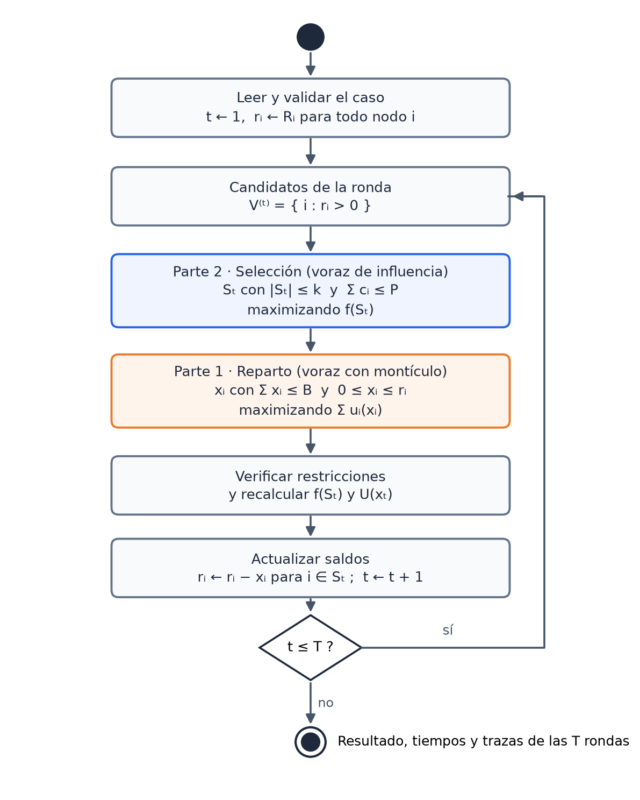

*Figura 1. Diagrama de actividades (UML) de la solución base para un caso de T rondas.*

### 3.4 Supuestos

Los casos de prueba traen los datos, pero no dicen con qué fórmulas se combinan. Tomamos los siguientes supuestos y explicamos por qué cada uno es razonable. Todos están concentrados en dos archivos del código, así que se pueden cambiar sin tocar los algoritmos.

1. **Utilidad del reparto logarítmica.** Darle x unidades de ruido al nodo i en una ronda vale uᵢ(x) = aᵢ·ln(1 + x). El enunciado pide una utilidad creciente y cóncava, y el logaritmo es la forma más usada para modelar rendimientos decrecientes: duplicar el presupuesto no duplica el beneficio. Además, aᵢ escala la curva, que es justo el papel de un "coeficiente de utilidad".
2. **Utilidad conjunta por influencia.** El valor de un grupo S es el valor esperado de los nodos que quedan influidos por algún participante (sección 5.3). El enunciado pide una utilidad submodular y el único dato que relaciona nodos es el grafo de influencia; esta fórmula usa ese grafo y es submodular, como demostramos en el Lema 4.
3. **Grafo no dirigido.** Cada arista aparece una sola vez en el caso, así que tomamos wᵤᵥ = wᵥᵤ.
4. **Dos restricciones de selección a la vez.** En cada ronda se exige │Sₜ│ ≤ k y Σ cᵢ ≤ P. El caso trae los dos límites y no indica que uno reemplace al otro.
5. **Tope de presupuesto por nodo.** Ningún nodo pasa su Rᵢ, y solo participan nodos con saldo positivo.
6. **Sin fallas de nodos.** El caso no trae información sobre fallas entre rondas. Ese escenario es la variante de rondas con fallas, que se trabaja para la entrega final.

## 4. Parte 1: reparto óptimo del presupuesto

### 4.1 Tamaño de la entrada

El tamaño de la entrada son dos números: **n**, la cantidad de participantes de la ronda (n = │S│ ≤ k), y **B**, el presupuesto de la ronda en unidades enteras.

El enunciado toma como tamaño solo la cantidad de nodos. Agregamos B porque el algoritmo entrega el presupuesto unidad por unidad: su tiempo crece con el valor de B y no solo con n. Hay que distinguir el valor de B de su longitud. Escribir B en binario ocupa β bits, con

$$
\beta = \lceil \log_2 (B + 1) \rceil
$$

así que un tiempo proporcional a B es proporcional a 2ᵝ, exponencial en la longitud de B. Un algoritmo así se llama **pseudo-polinomial**: es polinomial en el valor de los números de la entrada, pero no en su longitud. Volvemos a esto en las secciones 4.9 y 7.2.

### 4.2 Entrada

- El grupo S de participantes de la ronda, con n = │S│.
- El presupuesto de la ronda, un entero B ≥ 0.
- Para cada i ∈ S, su coeficiente aᵢ > 0 y su saldo rᵢ = rᵢ⁽ᵗ⁾ ≥ 0.
- Evaluar uᵢ en un punto cuesta tiempo constante, O(1).

### 4.3 Salida

Un vector de enteros x = (xᵢ), con i ∈ S, donde xᵢ es la cantidad de unidades de ruido que recibe el nodo i en la ronda.

### 4.4 Objetivo y restricciones: programa entero

La Parte 1 es el siguiente programa entero no lineal:

$$
\max_{x} \; U(x) = \sum_{i \in S} a_i \ln(1 + x_i)
$$

$$
\text{s.a.} \quad \sum_{i \in S} x_i \le B, \qquad 0 \le x_i \le r_i, \qquad x_i \in \mathbb{Z}, \quad i \in S
$$

| Restricción | Significado |
|---|---|
| Σᵢ xᵢ ≤ B | No se gasta más presupuesto del que tiene la ronda |
| 0 ≤ xᵢ ≤ rᵢ | Nadie recibe una cantidad negativa ni pasa su saldo |
| xᵢ ∈ ℤ | El presupuesto se reparte en unidades enteras |

Es un problema de **asignación de recursos con objetivo separable y cóncavo**: el objetivo es una suma de funciones de una sola variable, cada una cóncava. Esa estructura es la que permite resolverlo de forma exacta con un algoritmo voraz.

### 4.5 Propiedades de la utilidad

**Definición 1 (concavidad discreta).** Una función u: ℤ≥0 → ℝ es cóncava si su ganancia marginal g(t) = u(t) − u(t − 1) no crece: g(t + 1) ≤ g(t) para todo t ≥ 1. Es creciente si g(t) ≥ 0 para todo t.

**Lema 1.** uᵢ(x) = aᵢ·ln(1 + x) es estrictamente creciente y cóncava sobre los enteros no negativos.

**Demostración.** Su ganancia marginal es

$$
g_i(t) = u_i(t) - u_i(t-1) = a_i \ln\left(\frac{t+1}{t}\right), \qquad t \ge 1
$$

que es positiva porque (t + 1)/t > 1 y aᵢ > 0. Para la concavidad comparamos dos ganancias seguidas:

$$
g_i(t+1) - g_i(t) = a_i \ln\left(\frac{t+2}{t+1}\right) - a_i \ln\left(\frac{t+1}{t}\right) = a_i \ln\left(\frac{t(t+2)}{(t+1)^2}\right)
$$

Como t(t + 2) = (t + 1)² − 1 < (t + 1)², el argumento del logaritmo es menor que 1, el logaritmo es negativo y g(t + 1) < g(t). ∎

**Lema 2 (el tope conserva la concavidad).** Sea ûᵢ(x) = uᵢ(min(x, rᵢ)). Entonces ûᵢ es creciente y cóncava, y el problema con restricción xᵢ ≤ rᵢ tiene el mismo óptimo que el problema sin esa restricción usando ûᵢ.

$$
\hat{u}_i(x) = u_i(\min(x, r_i))
$$

**Demostración.** La ganancia marginal de ûᵢ es gᵢ(t) para t ≤ rᵢ y 0 para t > rᵢ. Hasta rᵢ es la secuencia decreciente del Lema 1; después vale 0, que es menor o igual que cualquier gᵢ(t) > 0. La secuencia completa no crece, así que ûᵢ es cóncava, y no es negativa, así que es creciente. Además, en cualquier solución sin la restricción, si xᵢ > rᵢ se puede bajar a rᵢ sin cambiar ûᵢ y liberando presupuesto, así que siempre hay un óptimo que la cumple. ∎

La Figura 2 muestra las dos propiedades con tres nodos de ejemplo: a la izquierda las utilidades (la del nodo con tope se vuelve plana en rᵢ = 3) y a la derecha sus ganancias marginales, que nunca crecen.

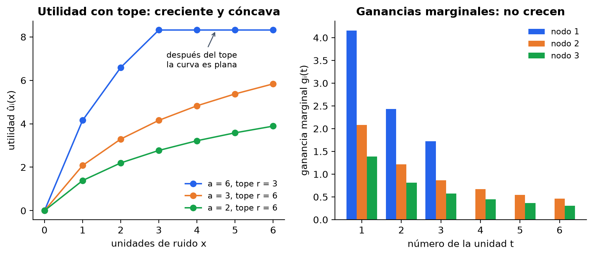

*Figura 2. Utilidades con tope (izquierda) y sus ganancias marginales (derecha) para a = (6, 3, 2) y r = (3, 6, 6).*

### 4.6 Interpretación continua: el nivel de agua

Para entender por qué funciona el voraz conviene mirar primero la versión continua, con xᵢ ∈ ℝ. Las condiciones de optimalidad de Karush-Kuhn-Tucker dicen que en el óptimo existe un número λ ≥ 0, el multiplicador de la restricción de presupuesto, tal que cada nodo recibe presupuesto hasta que su utilidad marginal baja a λ. Con la utilidad logarítmica esto da una fórmula cerrada:

$$
\frac{a_i}{1 + x_i} = \lambda \quad \Longrightarrow \quad x_i(\lambda) = \min\left(r_i, \max\left(0, \frac{a_i}{\lambda} - 1\right)\right)
$$

y λ es el valor que hace que el presupuesto se gaste completo, Σ xᵢ(λ) = B. La imagen es la de un recipiente que se llena con agua: λ es el nivel y cada nodo recibe hasta que su ganancia marginal llega a ese nivel. En la versión entera pasa lo mismo: todas las unidades entregadas tienen ganancia mayor o igual que λ y todas las que no se entregaron tienen ganancia menor o igual. El voraz construye exactamente ese reparto, unidad por unidad, empezando por las de mayor ganancia.

### 4.7 Algoritmo voraz con montículo

El voraz entrega una unidad a la vez al nodo cuya siguiente unidad vale más. Para encontrar ese nodo rápido usa un montículo de máximos H que guarda, para cada nodo, la ganancia de su siguiente unidad.

```text
VORAZ-REPARTO(S, a, r, B)
1   para cada i en S:  x[i] ← 0
2   H ← montículo de máximos con los pares (gᵢ(1), i), i en S        ▷ heapify
3   repetir B veces:
4       (g, i) ← raíz de H
5       si g = 0:  terminar                       ▷ todos agotaron su saldo
6       x[i] ← x[i] + 1
7       reemplazar la raíz de H por (gᵢ(x[i] + 1), i)              ▷ heapreplace
8   devolver x
```

Las ganancias gᵢ son las de ûᵢ, así que cuando un nodo llega a su saldo su siguiente ganancia es 0 y el voraz no le vuelve a dar nada mientras haya otra unidad con ganancia positiva.

### 4.8 Correctitud

**Lema 3 (invariante).** Al empezar cada iteración del ciclo, el par que H guarda para el nodo i es (gᵢ(xᵢ + 1), i), y la raíz de H es la mayor ganancia disponible entre todos los nodos.

**Demostración.** Al principio xᵢ = 0 y H contiene gᵢ(1) para todos. Cuando se entrega una unidad a i, xᵢ aumenta en 1 y el paso 7 reemplaza su par por gᵢ(xᵢ + 1); los demás pares no cambian. Como gᵢ no crece (Lema 2), la siguiente unidad de cada nodo es la mejor que le queda, y la raíz del montículo es el máximo de esas mejores unidades. ∎

**Teorema 1 (optimalidad).** El voraz devuelve un reparto óptimo del programa de la sección 4.4.

**Demostración (argumento de intercambio).** Sea G el reparto del voraz. Si el voraz paró antes de gastar B (paso 5), todas las unidades que quedan tienen ganancia 0, así que gastarlas no cambia la utilidad; podemos suponer sin perder generalidad que G y cualquier óptimo gastan lo mismo. Sea O el reparto óptimo más parecido a G, en el sentido de la distancia d(O, G) = Σᵢ │Oᵢ − Gᵢ│. Supongamos que O ≠ G. Como ambos gastan lo mismo, hay un nodo i con Oᵢ > Gᵢ y otro j con Oⱼ < Gⱼ.

Construimos O′ quitándole a i su última unidad y dándosela a j. El cambio en la utilidad es

$$
\Delta = g_j(O_j + 1) - g_i(O_i)
$$

Mostramos que Δ ≥ 0 con tres desigualdades:

1. gⱼ(Oⱼ + 1) ≥ gⱼ(Gⱼ), por concavidad, porque Oⱼ + 1 ≤ Gⱼ.
2. Cuando el voraz le dio a j su unidad número Gⱼ, el nodo i tenía y ≤ Gᵢ unidades y su unidad disponible valía gᵢ(y + 1). Por el Lema 3 el voraz eligió la raíz del montículo, así que gⱼ(Gⱼ) ≥ gᵢ(y + 1).
3. gᵢ(y + 1) ≥ gᵢ(Gᵢ + 1) ≥ gᵢ(Oᵢ), por concavidad, porque y + 1 ≤ Gᵢ + 1 ≤ Oᵢ.

Encadenando, Δ ≥ 0, así que O′ también es óptimo. Pero d(O′, G) = d(O, G) − 2, lo que contradice que O fuera el óptimo más parecido a G. Por lo tanto O = G. ∎

**La concavidad es necesaria.** Con u₁(x) = x, u₂(1) = 0, u₂(2) = 10 y B = 2, la utilidad u₂ no es cóncava. El voraz le da las dos unidades al nodo 1 (su primera unidad vale 1 contra 0) y obtiene 2, mientras que el óptimo es darle las dos al nodo 2 y obtener 10. En la demostración, la concavidad se usa en los pasos 1 y 3.

### 4.9 Función de eficiencia

Contamos las operaciones línea por línea. Leer o escribir un número, compararlo y evaluar uᵢ cuestan O(1).

| Línea | Operaciones | Veces | Costo |
|---|---|---|---|
| 1 | Asignar xᵢ = 0 | n | O(n) |
| 2 | Evaluar gᵢ(1) y construir el montículo (heapify) | 1 | O(n) |
| 4 | Leer la raíz | B | O(1) cada vez |
| 5 | Comparar con 0 | B | O(1) cada vez |
| 6 | Sumar una unidad | B | O(1) cada vez |
| 7 | Evaluar una ganancia y hundir la nueva raíz | B | O(log n) cada vez |

**Costo de construir el montículo.** El heapify hunde cada nodo interno desde su altura h, con a lo sumo 2 comparaciones por nivel. En un montículo de n elementos hay a lo sumo ⌈n/2ʰ⁺¹⌉ nodos a altura h, así que el total de comparaciones es

$$
C_{heapify}(n) \le \sum_{h=0}^{\lfloor \log_2 n \rfloor} \frac{n}{2^{h+1}} \cdot 2h = n \sum_{h \ge 1} \frac{h}{2^h} = 2n
$$

**Costo de reemplazar la raíz.** La nueva raíz baja por un camino de altura a lo sumo ⌊log₂ n⌋ con 2 comparaciones por nivel: a lo sumo 2⌊log₂ n⌋ comparaciones.

Sumando las líneas, con constantes c₁, c₂ y c₃ que dependen de la máquina:

$$
T(n, B) = c_1 n + B\,(c_2 + c_3 \log_2 n) = O(n + B \log n)
$$

El espacio adicional es O(n), el montículo y el vector x. Como n ≤ k, en una ronda T = O(k + B log k). En términos de la longitud β de B el tiempo es O(n + 2ᵝ·log n): pseudo-polinomial, como anticipamos.

**Relación con el enunciado.** El enunciado da T(N, B) = O(B log N), que es el costo del ciclo. Nuestra deducción agrega el término O(n) de construir el montículo, que solo importa cuando hay muchos más nodos que unidades de presupuesto (n > B log n). En los casos del proyecto B ≥ n, así que los dos resultados coinciden.

### 4.10 Ejemplo paso a paso

Tres nodos con a = (6, 3, 2), saldos r = (3, 6, 6) y B = 6. Las ganancias de cada unidad salen de la ecuación del Lema 1; el nodo 1 tiene tope 3, así que su cuarta unidad vale 0.

| Unidad | Nodo elegido | Ganancia | Mejores alternativas en ese momento |
|---|---|---|---|
| 1 | 1 | 4,159 | nodo 2: 2,079 · nodo 3: 1,386 |
| 2 | 1 | 2,433 | nodo 2: 2,079 · nodo 3: 1,386 |
| 3 | 2 | 2,079 | nodo 1: 1,726 · nodo 3: 1,386 |
| 4 | 1 | 1,726 | nodo 3: 1,386 · nodo 2: 1,216 |
| 5 | 3 | 1,386 | nodo 2: 1,216 · nodo 1: 0 (tope) |
| 6 | 2 | 1,216 | nodo 2: 0,863 · nodo 3: 0,811 |

El reparto final es x = (3, 2, 1) con U = 6 ln 4 + 3 ln 3 + 2 ln 2 ≈ 13,000, igual al óptimo que da la programación dinámica exacta. La Figura 3 lo muestra como nivel de agua: las seis unidades entregadas valen al menos 1,216 y la mejor que quedó sin entregar vale 0,863, así que cualquier λ entre esos dos valores separa unas de otras.

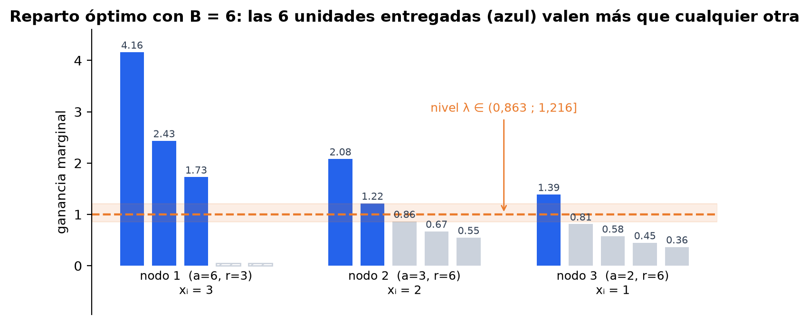

*Figura 3. El reparto del ejemplo como nivel de agua: azul = unidades entregadas, gris = no entregadas, rayado = unidades después del tope.*

## 5. Parte 2: selección de participantes

### 5.1 Tamaño de la entrada

El tamaño de la entrada es **N**, la cantidad de nodos candidatos, junto con **k**, el cupo de la ronda (k < N). El número de grupos posibles de a lo sumo k nodos es Σⱼ≤ₖ C(N, j), que crece con los dos valores. La utilidad conjunta se calcula a partir de W, una matriz de N × N, así que la longitud de la entrada es Θ(N²) números más los costos y los coeficientes. Llamamos τ al costo de evaluar una ganancia marginal; con la utilidad de influencia τ = O(N).

### 5.2 Entrada y salida

- **Entrada:** los candidatos V⁽ᵗ⁾ = {i : rᵢ⁽ᵗ⁾ > 0}, la matriz de influencia W, los coeficientes aᵥ, los costos cᵢ, el cupo k y el límite de costos P.
- **Salida:** un grupo S ⊆ V⁽ᵗ⁾ de participantes.

### 5.3 La utilidad de influencia

**Definición 2.** Para un grupo S de participantes y un nodo v, sea

$$
q_v(S) = \prod_{u \in S} (1 - w_{uv})
$$

la probabilidad de que v no quede influido por ningún participante. La utilidad conjunta es

$$
f(S) = \sum_{v \in V} a_v \left(1 - q_v(S)\right) = \sum_{v \in V} a_v \left(1 - \prod_{u \in S} (1 - w_{uv})\right)
$$

**Interpretación probabilística.** Supongamos que cada participante u influye a cada nodo v de forma independiente con probabilidad wᵤᵥ. Entonces v queda influido por S con probabilidad 1 − qᵥ(S), y por linealidad de la esperanza f(S) es el valor esperado de los nodos influidos:

$$
f(S) = \mathbb{E}\left[\sum_{v \in V} a_v I_v(S)\right], \qquad I_v(S) = 1 \text{ si } v \text{ queda influido por } S, \; 0 \text{ si no}
$$

Como wᵥᵥ = 1, un participante siempre se influye a sí mismo: qᵥ(S) = 0 para v ∈ S, y cada participante aporta su aᵥ completo.

### 5.4 Objetivo y restricciones

La Parte 2 es el problema de optimización combinatoria

$$
\max_{S \subseteq V^{(t)}} \; f(S) \qquad \text{s.a.} \qquad |S| \le k, \qquad \sum_{i \in S} c_i \le P
$$

Con variables binarias yᵤ ∈ {0, 1} (yᵤ = 1 si u participa) se escribe como un programa no lineal en enteros:

$$
\max_{y \in \{0,1\}^N} \; \sum_{v} a_v \left(1 - \prod_{u} (1 - w_{uv}\, y_u)\right) \qquad \text{s.a.} \qquad \sum_u y_u \le k, \quad \sum_u c_u y_u \le P
$$

| Restricción | Significado |
|---|---|
| S ⊆ V⁽ᵗ⁾ | Solo participan nodos con saldo positivo |
| │S│ ≤ k | No se pasa del cupo de la ronda |
| Σᵢ∈S cᵢ ≤ P | No se pasa del límite de costos de participación |

### 5.5 La utilidad es monótona y submodular

**Definición 3.** Una función de conjuntos f es **monótona** si A ⊆ A′ implica f(A) ≤ f(A′), y es **submodular** si tiene rendimientos decrecientes: para A ⊆ A′ e i ∉ A′,

$$
f(A \cup \{i\}) - f(A) \ge f(A' \cup \{i\}) - f(A')
$$

**Lema 4.** La utilidad de influencia cumple f(∅) = 0, es monótona y es submodular.

**Demostración.** Si S = ∅, el producto vacío vale 1 para todo v y f(∅) = 0. Para las otras dos propiedades calculamos la ganancia de agregar i ∉ S:

$$
\Delta_i(S) = f(S \cup \{i\}) - f(S) = \sum_{v \in V} a_v \left[ q_v(S) - q_v(S)(1 - w_{iv}) \right] = \sum_{v \in V} a_v \, q_v(S) \, w_{iv}
$$

Cada término es producto de números no negativos, así que Δᵢ(S) ≥ 0: agregar un nodo nunca baja f, y f es monótona. Para la submodularidad, si A ⊆ A′ entonces qᵥ(A′) = qᵥ(A)·Πᵤ∈A′∖A (1 − wᵤᵥ) ≤ qᵥ(A), porque cada factor está en [0, 1]. Como aᵥ ≥ 0 y wᵢᵥ ≥ 0, cada término de Δᵢ(A′) es menor o igual que el término correspondiente de Δᵢ(A):

$$
\Delta_i(A') = \sum_{v} a_v \, q_v(A') \, w_{iv} \le \sum_{v} a_v \, q_v(A) \, w_{iv} = \Delta_i(A)
$$

que es la definición de submodularidad. ∎

En palabras: un nodo nuevo aporta menos cuanto más influida está ya la red, porque muchos de los nodos que él influiría ya los influía otro participante.

### 5.6 Cálculo eficiente de la ganancia marginal

La fórmula de Δᵢ(S) de la demostración da un cálculo en O(N) si se guardan los valores qᵥ(S). Al agregar un nodo j al grupo, cada qᵥ se actualiza con una sola multiplicación:

$$
q_v(S \cup \{j\}) = q_v(S)\,(1 - w_{jv})
$$

Así, evaluar la ganancia de un candidato cuesta τ = O(N) y actualizar el estado después de cada elección también cuesta O(N), en lugar de recalcular f desde cero en O(N·│S│).

### 5.7 Versión de decisión

Para hablar de NP-dureza usamos versiones de decisión. Como el enunciado plantea la Parte 2 para una utilidad submodular cualquiera, y nosotros usamos una en particular, definimos dos:

**SELECCIÓN-SUB.** Dados un conjunto V, una función f monótona y submodular que se puede evaluar en tiempo polinomial (dada por una descripción explícita, por ejemplo una lista de conjuntos), costos c, un cupo k, un límite P y un umbral t, ¿existe S ⊆ V con │S│ ≤ k, Σᵢ∈S cᵢ ≤ P y f(S) ≥ t?

**SELECCIÓN-INF.** El caso particular de SELECCIÓN-SUB en el que f es la utilidad de influencia: dados V, W, a, c, k, P y t, ¿existe S ⊆ V con │S│ ≤ k, Σᵢ∈S cᵢ ≤ P y f(S) ≥ t?

Si SELECCIÓN-INF es difícil, SELECCIÓN-SUB también lo es, porque la contiene. Aun así damos las dos reducciones: la primera es la que pide el enunciado y la segunda muestra que la dificultad no desaparece al fijar nuestra utilidad.

### 5.8 Ejemplo con cinco nodos

Cinco nodos A, B, C, D, E con a = (5, 3, 3, 5, 1), cinco aristas (A–D: 0,2; B–C: 0,6; B–E: 0,2; C–D: 0,2; D–E: 0,4), k = 2 y sin costos. En el primer paso el voraz evalúa la utilidad de cada nodo solo:

| Nodo | A | B | C | D | E |
|---|---|---|---|---|---|
| Δ(∅) = f({i}) | 6,0 | 5,0 | 5,8 | 7,0 | 3,6 |
| Δ({D}) | 4,0 | 4,56 | 4,2 | — | 1,2 |

Elige D (7,0). Después de elegir D los saldos de no influencia son q = (0,8; 1; 0,8; 0; 0,6), y las nuevas ganancias son las de la segunda fila: elige B (4,56) y termina con f({D, B}) = 11,56. Sin embargo, el mejor par es {A, C} con f = 11,60. El voraz no es óptimo aquí, pero queda a una razón de 11,56/11,60 ≈ 0,997, muy por encima de la garantía de 0,632 que demostramos en la sección 8.3. La Figura 4 muestra los dos grupos y la probabilidad con que cada nodo queda influido.

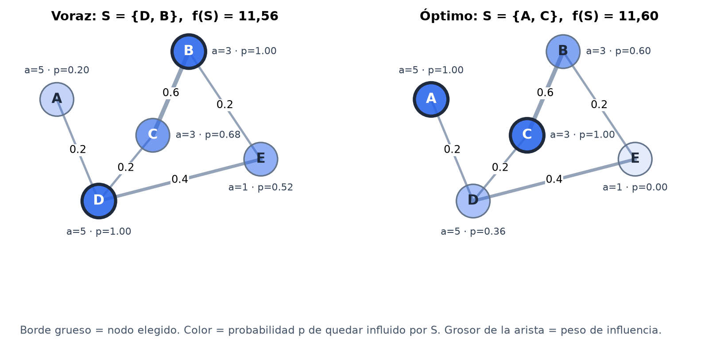

*Figura 4. Ejemplo de cinco nodos: grupo elegido por el voraz (izquierda) y grupo óptimo (derecha).*

## 6. El problema completo de T rondas

La salida de un caso completo es la secuencia de decisiones (S₁, x₁), (S₂, x₂), …, una por cada una de las T rondas. Además de las restricciones de cada ronda, la restricción de presupuesto total (sección 3.3) une las rondas entre sí: lo que un nodo gasta en una ronda ya no lo tiene en las siguientes.

El objetivo de cada ronda tiene dos niveles: primero elegir el grupo que maximiza la utilidad conjunta f(Sₜ) y, con ese grupo fijo, repartir el presupuesto para maximizar U(xₜ). La solución base resuelve las rondas una por una en ese orden y actualiza los saldos al final de cada una. Es una estrategia **miope**: no reserva presupuesto pensando en las rondas siguientes. Tiene dos ventajas: cada subproblema conserva sus garantías (el reparto es óptimo para el grupo elegido y la selección tiene la garantía de la sección 8), y el tiempo total es simplemente T veces el de una ronda. Planear las T rondas juntas, incluyendo fallas de nodos, es la variante de rondas de la entrega final.

## 7. Complejidad computacional

### 7.1 Definiciones

Un **problema de decisión** es uno cuya respuesta es sí o no. La clase **P** contiene los problemas de decisión que se resuelven en tiempo polinomial en la longitud de la entrada. La clase **NP** contiene los problemas cuyas respuestas sí tienen un certificado que se verifica en tiempo polinomial. Un problema A se **reduce polinomialmente** a un problema B (A ≤ₚ B) si existe una función f, calculable en tiempo polinomial, tal que x es una instancia positiva de A si y solo si f(x) es una instancia positiva de B. Un problema es **NP-difícil** si todo problema de NP se reduce a él, y **NP-completo** si además está en NP.

La herramienta práctica es la siguiente: si A es NP-difícil y A ≤ₚ B, entonces B es NP-difícil, porque un algoritmo polinomial para B daría uno para A (transformar y resolver). La reducción tiene que ir **desde** el problema conocido **hacia** el nuestro; al revés no demuestra nada.

### 7.2 La Parte 1 está en P

El voraz de la sección 4.7 es pseudo-polinomial. Aun así, el problema de asignación de recursos separable y cóncavo se puede resolver en tiempo polinomial en la longitud de la entrada: se busca el nivel λ de la sección 4.6 por bisección y se ajustan las unidades enteras alrededor de ese nivel (Hochbaum, 1994). Para los tamaños del proyecto (B = 30 por ronda) el voraz es más simple y más rápido en la práctica, y es el que pide el enunciado.

### 7.3 Los dos problemas están en NP

Un certificado es el grupo S. Para verificarlo basta revisar que │S│ ≤ k, que Σᵢ∈S cᵢ ≤ P y que f(S) ≥ t. Las dos primeras cuestan O(k), y la tercera es polinomial por definición en SELECCIÓN-SUB. En SELECCIÓN-INF, calcular f(S) con la Definición 2 cuesta O(N·k) operaciones aritméticas; si los pesos son números racionales de L bits, cada producto tiene a lo sumo k·L bits, así que todo el cálculo es polinomial en la longitud de la entrada.

### 7.4 Primera reducción: desde Cobertura Máxima

Esta es la reducción que pide el enunciado. Muestra que SELECCIÓN-SUB es NP-difícil.

**COBERTURA-MÁXIMA.** Dados un universo U, una colección de subconjuntos S₁, …, Sₘ ⊆ U y dos enteros k y t, ¿existen k subconjuntos cuya unión tenga al menos t elementos? Es NP-completo: Cobertura de Conjuntos, uno de los 21 problemas de Karp (1972), es el caso t = │U│.

**Construcción.** Por cada subconjunto Sᵢ creamos un nodo i con costo cᵢ = 0; tomamos P = 0, el mismo cupo k y el mismo umbral t; y como utilidad conjunta la cantidad de elementos cubiertos:

$$
f(A) = \left| \bigcup_{i \in A} S_i \right|
$$

Esta f es monótona y submodular: un subconjunto nuevo aporta los elementos que todavía no están cubiertos, y esos son menos cuanto más grande es el grupo. Además se evalúa en tiempo polinomial a partir de la lista de subconjuntos, así que la instancia construida es una instancia válida de SELECCIÓN-SUB. La construcción recorre U y cada Sᵢ una vez: O(│U│ + Σᵢ │Sᵢ│). La Figura 5 muestra la construcción con un ejemplo: U = {1, …, 6}, S₁ = {1, 2, 3}, S₂ = {4, 5, 6} y S₃ = {1, 2, 4, 5}. Con k = 2 y t = 6 la respuesta es sí, porque S₁ ∪ S₂ = U, y en el caso construido los nodos 1 y 2 dan f = 6 ≥ t.

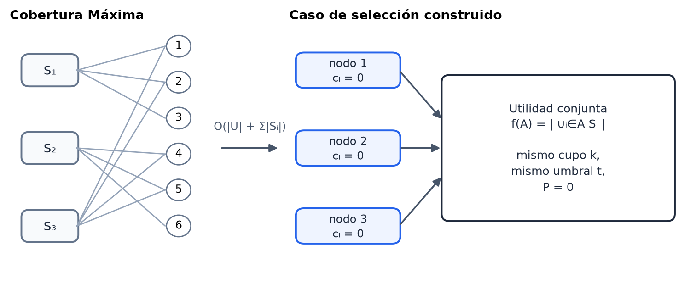

*Figura 5. Reducción desde Cobertura Máxima: cada subconjunto se vuelve un nodo y la utilidad cuenta los elementos cubiertos.*

**Equivalencia.** (⇒) Si hay k subconjuntos cuya unión tiene al menos t elementos, esos k nodos forman un grupo con │A│ = k, costo 0 ≤ P y f(A) ≥ t. (⇐) Si un grupo A con │A│ ≤ k da f(A) ≥ t, lo completamos con subconjuntos cualesquiera hasta tener k; la unión no se achica y seguimos cubriendo al menos t elementos. ∎

Por lo tanto COBERTURA-MÁXIMA ≤ₚ SELECCIÓN-SUB.

### 7.5 Segunda reducción: desde Conjunto Dominante

Esta reducción muestra que SELECCIÓN-INF, con la utilidad de influencia que usamos para los casos de prueba, también es NP-difícil.

**CONJUNTO-DOMINANTE.** Dados un grafo G = (V, E) y un entero k, ¿existe D ⊆ V con │D│ ≤ k tal que todo vértice está en D o tiene un vecino en D? Es NP-completo (Garey y Johnson, 1979).

**Construcción.** Usamos los mismos nodos y el mismo cupo k; aᵥ = 1 para todo v; wᵤᵥ = 1 si {u, v} ∈ E y wᵤᵥ = 0 si no; cᵢ = 0 con P = 0; y el umbral t = │V│. Si k ≥ │V│ la respuesta es trivialmente sí y devolvemos cualquier instancia positiva. Construir W cuesta O(│V│²). La Figura 6 muestra la construcción sobre un grafo de seis vértices.

**Lema 5.** Con pesos 0 o 1, f(S) es la cantidad de vértices dominados por S.

**Demostración.** El producto qᵥ(S) = Πᵤ∈S (1 − wᵤᵥ) vale 0 si algún factor es 0, es decir, si v ∈ S (porque wᵥᵥ = 1) o si v tiene un vecino en S; y vale 1 si no. Llamando N[S] a los vértices dominados por S:

$$
q_v(S) = 0 \iff v \in N[S] \qquad \Longrightarrow \qquad f(S) = \sum_{v \in V} \left(1 - q_v(S)\right) = |N[S]|
$$

∎

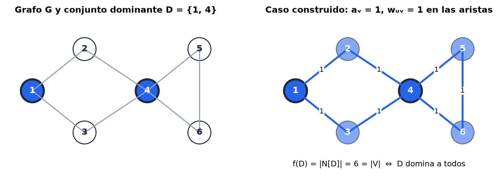

*Figura 6. Reducción desde Conjunto Dominante: con pesos 1 en las aristas, f(S) cuenta los vértices dominados.*

**Equivalencia.** (⇒) Si G tiene un conjunto dominante D con │D│ ≤ k, por el Lema 5 f(D) = │V│ = t. (⇐) Si un grupo S con │S│ ≤ k da f(S) ≥ │V│, como f(S) = │N[S]│ ≤ │V│, S domina todos los vértices y es un conjunto dominante de tamaño a lo sumo k. ∎

Por lo tanto CONJUNTO-DOMINANTE ≤ₚ SELECCIÓN-INF.

### 7.6 Conclusión de complejidad

**Teorema 2.** SELECCIÓN-SUB y SELECCIÓN-INF son NP-completos.

**Demostración.** Los dos están en NP por la sección 7.3. SELECCIÓN-SUB es NP-difícil por la reducción de la sección 7.4 y SELECCIÓN-INF por la de la sección 7.5. ∎

Hay tres consecuencias. Primero, salvo que P = NP no existe un algoritmo exacto polinomial para la Parte 2, así que en casos grandes hay que aproximar. Segundo, la versión de optimización es al menos igual de difícil, porque conociendo el óptimo S* basta comparar f(S*) con t. Tercero, Feige (1998) demostró que, salvo que P = NP, ningún algoritmo polinomial aproxima Cobertura Máxima con razón mejor que 1 − 1/e; como Cobertura Máxima es un caso particular, la garantía del voraz de la sección 8.3 es la mejor posible para la clase general.

## 8. Algoritmos para la Parte 2

### 8.1 Algoritmo exacto: fuerza bruta

```text
FUERZA-BRUTA(V, f, c, k, P)
1   mejor ← ∅ ;  valor ← 0
2   para j ← 1 hasta k:
3       para cada A ⊆ V con |A| = j:
4           si Σᵢ∈A cᵢ ≤ P  y  f(A) > valor:
5               mejor ← A ;  valor ← f(A)
6   devolver mejor
```

Con el límite de costos el óptimo puede usar menos de k nodos, así que se revisan todos los tamaños. Hay Σⱼ≤ₖ C(N, j) grupos y cada uno se evalúa en O(N·k) (sección 7.3):

$$
T_{FB}(N, k) = O\left(N k \sum_{j=0}^{k} \binom{N}{j}\right), \qquad \sum_{j=0}^{k} \binom{N}{j} \le \left(\frac{eN}{k}\right)^{k}
$$

Con k = N/2 la suma es al menos 2ᴺ⁻¹, así que el tiempo es exponencial. En el caso de 15 nodos con k = 5 son 1 + 15 + 105 + 455 + 1 365 + 3 003 = 4 944 grupos, pocos para un computador. Por eso la usamos como referencia para comprobar al voraz en casos pequeños.

### 8.2 Algoritmo aproximado: voraz

```text
VORAZ-SELECCIÓN(V, a, W, c, k, P)
1   S ← ∅ ;  gastado ← 0 ;  q[v] ← 1 para todo v
2   repetir k veces:
3       mejor ← nada ;  Δmejor ← −1
4       para cada i en V \ S con gastado + cᵢ ≤ P:
5           Δ ← Σᵥ aᵥ · q[v] · w[i][v]                 ▷ O(N)
6           si Δ > Δmejor:  mejor ← i ;  Δmejor ← Δ
7       si mejor = nada:  terminar                      ▷ ningún candidato cabe
8       S ← S ∪ {mejor} ;  gastado ← gastado + c_mejor
9       para cada v:  q[v] ← q[v] · (1 − w[mejor][v])     ▷ O(N)
10  devolver S
```

**Conteo de operaciones.** En el paso t (contando desde 0) quedan a lo sumo N − t candidatos, así que el número de evaluaciones de la línea 5 es

$$
E(N, k) \le \sum_{t=0}^{k-1} (N - t) = kN - \frac{k(k-1)}{2} \le Nk
$$

Cada evaluación cuesta O(N) y la actualización de la línea 9 cuesta O(N) por paso:

$$
T_{V}(N, k) = E(N, k) \cdot O(N) + k \cdot O(N) = O(N^2 k)
$$

Sin límite de costos la cota de E(N, k) es exacta; el programa la verifica contando las evaluaciones (sección 10.2). El espacio adicional es O(N), el vector q.

**Relación con el enunciado.** El enunciado da T(N, k) = O(N·k), que cuenta evaluaciones de la ganancia suponiendo que cada una cuesta O(1). Eso es exactamente nuestro E(N, k) ≤ N·k. La diferencia está en τ: con la utilidad de influencia una evaluación recorre los N nodos de la red, así que τ = O(N) y el tiempo es O(N·k·τ) = O(N²·k). Con un grafo disperso se podrían recorrer solo los vecinos de i y τ bajaría al grado del nodo.

### 8.3 Garantía de aproximación (1 − 1/e)

**Teorema 3 (Nemhauser, Wolsey y Fisher, 1978).** Si f es monótona, submodular y f(∅) = 0, y la única restricción es │S│ ≤ k, el voraz devuelve un grupo Sₖ con

$$
f(S_k) \ge \left(1 - \left(1 - \frac{1}{k}\right)^{k}\right) f(O) \ge \left(1 - \frac{1}{e}\right) f(O) \approx 0.632\, f(O)
$$

donde O es un grupo óptimo. Por el Lema 4, la utilidad de influencia cumple las hipótesis.

**Demostración.** Sea Sₜ el grupo del voraz tras t pasos y δₜ = f(O) − f(Sₜ). Por monotonía f(O) ≤ f(Sₜ ∪ O). Si agregamos los elementos de O a Sₜ uno por uno, por submodularidad cada uno aporta a lo sumo su ganancia respecto a Sₜ. Y cada una de esas ganancias es a lo sumo la que eligió el voraz, porque el voraz toma la mayor:

$$
f(O) \le f(S_t \cup O) \le f(S_t) + \sum_{o \in O} \Delta_o(S_t) \le f(S_t) + k \left(f(S_{t+1}) - f(S_t)\right)
$$

Restando f(Sₜ) a ambos lados queda δₜ ≤ k(δₜ − δₜ₊₁), es decir, en cada paso lo que falta se reduce al menos en un factor (1 − 1/k). Empezando en δ₀ = f(O) y usando 1 − x ≤ e⁻ˣ:

$$
\delta_{t+1} \le \left(1 - \frac{1}{k}\right) \delta_t \quad \Longrightarrow \quad \delta_k \le \left(1 - \frac{1}{k}\right)^{k} f(O) \le e^{-1} f(O)
$$

y por lo tanto f(Sₖ) = f(O) − δₖ ≥ (1 − 1/e)·f(O). ∎

### 8.4 Qué cambia con el límite de costos

Con la restricción Σ cᵢ ≤ P la garantía del Teorema 3 ya no aplica, porque el paso "cada ganancia de O es a lo sumo la elegida" falla: el voraz puede elegir un nodo caro que agota el presupuesto. Un ejemplo con k = 5 y P = 10: un nodo X con costo 10 y f({X}) = 10, y cinco nodos Y₁, …, Y₅ con costo 2 y utilidad 9 cada uno, sin traslape. El voraz elige X primero (10 > 9) y ya no le cabe nada: obtiene 10. El óptimo elige los cinco Yⱼ y obtiene 45. Escalando los números, la razón se puede hacer tan pequeña como se quiera.

Este problema es la cobertura con presupuesto (budgeted maximum coverage). Khuller, Moss y Naor (1999) mostraron que tomar el mejor entre el voraz por razón ganancia/costo y el mejor nodo individual garantiza (1 − 1/e)/2, y que enumerar los grupos de hasta 3 nodos y completarlos con el voraz por razón garantiza (1 − 1/e). Implementar esas versiones es la variante de costos de la entrega final. En el caso de prueba el voraz simple encontró el óptimo en las tres rondas (sección 11), pero eso no está garantizado en general.

## 9. Algoritmo completo

```text
RESOLVER-CASO(caso)
1   validar el caso ;  r[i] ← Rᵢ para todo i
2   para t ← 1 hasta T:
3       Vₜ ← { i : r[i] > 0 }
4       Sₜ ← VORAZ-SELECCIÓN(Vₜ, a, W, c, k, P)              ▷ O(N² k)
5       xₜ ← VORAZ-REPARTO(Sₜ, a, r, B)                      ▷ O(k + B log k)
6       verificar restricciones y recalcular f(Sₜ), U(xₜ)    ▷ O(N k)
7       para cada i en Sₜ:  r[i] ← r[i] − xₜ[i]
8   devolver (S₁, x₁), …, (S_T, x_T) con trazas y tiempos
```

Sumando los costos de cada línea:

$$
T_{ronda} = O(N^2 k) + O(k + B \log k) + O(N k) = O(N^2 k + B \log k)
$$

$$
T_{caso} = T \cdot T_{ronda} = O\left(T \left(N^2 k + B \log k\right)\right)
$$

Leer y validar el caso cuesta O(N² + │E│), que no cambia el orden. Si además se calcula el óptimo de referencia por fuerza bruta en cada ronda, se suma T veces el costo de la fuerza bruta de la sección 8.1.

La verificación de la línea 6 revisa nueve condiciones por ronda: │Sₜ│ ≤ k, que no haya nodos repetidos, que todos sean candidatos válidos, que Σ cᵢ ≤ P, que Σ xᵢ ≤ B, que cada xᵢ sea entero no negativo, que xᵢ ≤ rᵢ, y que f(Sₜ) y U(xₜ) recalculados coincidan con los que devolvieron los algoritmos. Al final se revisa una más: que ningún nodo pase su presupuesto total.

## 10. Validación experimental

La teoría predice cuánto debe crecer el tiempo de cada algoritmo. Aquí lo medimos para valores crecientes del tamaño de la entrada y comparamos el crecimiento medido contra la función T(n) deducida. Cada tiempo es la mediana de varias ejecuciones, para filtrar el ruido del sistema operativo. Además del tiempo contamos operaciones (comparaciones del montículo y evaluaciones de la ganancia), porque ese conteo no depende de la máquina y valida la deducción de forma limpia.

### 10.1 Parte 1: voraz con montículo

Se hicieron dos barridos de 6 tamaños cada uno: N de 1 000 a 1 024 000 con B = 200 000 fijo, y B de 50 000 a 1 600 000 con N = 10 000 fijo. Como T(N, B) = c₁·N + c₂·B·log₂ N tiene dos constantes, las estimamos por mínimos cuadrados con todas las mediciones: c₁ ≈ 1,36·10⁻⁶ s por nodo y c₂ ≈ 8,09·10⁻⁸ s por paso del montículo, con R² = 0,969.

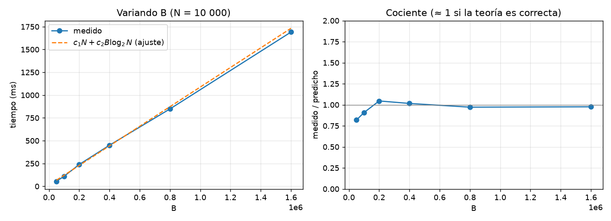

*Figura 7. Parte 1, tiempo al variar B con N = 10 000: medido contra c₁·N + c₂·B·log₂ N (izquierda) y cociente medido/predicho (derecha).*

Al variar B el crecimiento es lineal y el cociente medido/predicho se mantiene cerca de 1, como predice la teoría (Figura 7). Al variar N (Figura 8) el tiempo sigue la forma de N + B log N, pero el cociente sube en los tamaños grandes. La causa es la jerarquía de memoria: cuando el montículo deja de caber en la caché del procesador cada acceso cuesta más ciclos, y la notación O no modela ese efecto.

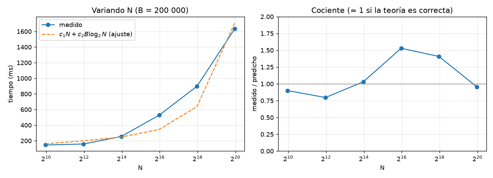

*Figura 8. Parte 1, tiempo al variar N con B = 200 000.*

Por eso el conteo de comparaciones es la validación más limpia (Figura 9). Con B = 20N y N de 64 a 262 144, el heapify hace entre 1,53·N y 1,65·N comparaciones, por debajo de la cota 2N de la sección 4.9, y los B reemplazos de la raíz hacen entre 1,06 y 1,19 veces B·log₂ N, por debajo de la cota 2·B·log₂ N. Los dos cocientes se estabilizan al crecer N, que es lo que se espera si la deducción es correcta.

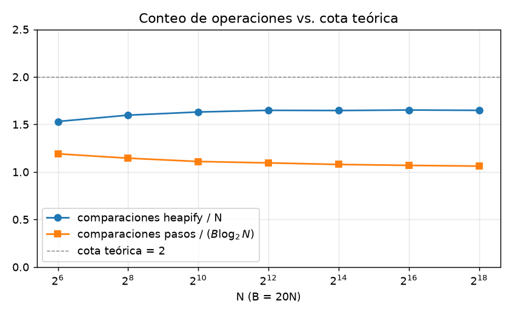

*Figura 9. Parte 1, comparaciones del montículo divididas por N (heapify) y por B·log₂ N (reemplazos), contra la cota teórica 2.*

### 10.2 Parte 2: voraz de influencia

Se hicieron dos barridos sobre grafos completos generados con semilla fija, como el del caso de prueba: N de 50 a 800 con k = 10 (7 tamaños), y k de 5 a 80 con N = 400 (5 tamaños). En los 12 puntos el número de evaluaciones de la ganancia fue **exactamente** kN − k(k − 1)/2, el valor deducido en la sección 8.2.

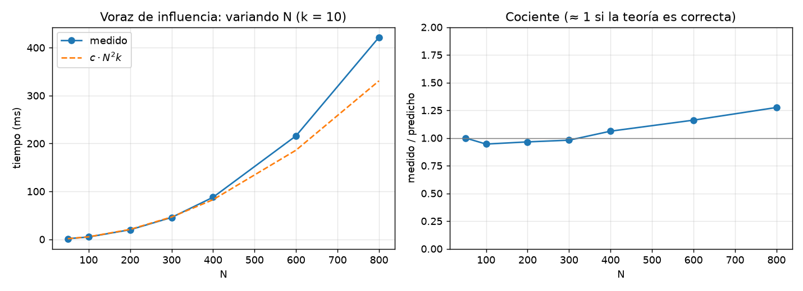

*Figura 10. Parte 2, tiempo del voraz de influencia al variar N con k = 10, contra c·N²·k.*

Si T(N, k) = c·N²·k, el cociente t/(N²·k) debe ser constante. Al variar k quedó entre 5,35·10⁻⁸ y 5,87·10⁻⁸ s: el crecimiento es lineal en k (Figura 11). Al variar N quedó entre 4,88·10⁻⁸ y 6,59·10⁻⁸ s: el tiempo crece como N² (Figura 10), con el mismo efecto de memoria de la Parte 1 en los tamaños grandes, donde la matriz W ocupa cientos de miles de números.

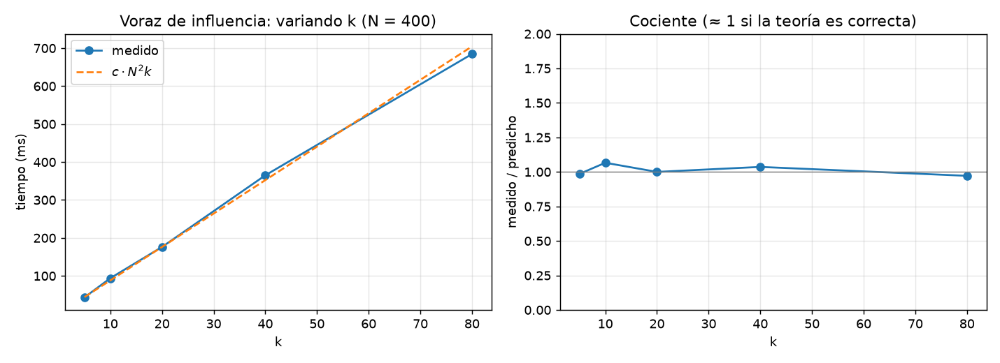

*Figura 11. Parte 2, tiempo del voraz de influencia al variar k con N = 400.*

### 10.3 La cota (1 − 1/e) en nuestros datos

El enunciado pide verificar en datos propios que la utilidad del voraz respeta la cota. Generamos 300 instancias con la utilidad de influencia (entre 8 y 12 nodos, k entre 2 y 4, densidad del grafo entre 0,3 y 0,9) y comparamos el voraz contra el óptimo por fuerza bruta en dos escenarios:

| Escenario | Razón mínima | Razón media | Voraz = óptimo | Por debajo de 1 − 1/e |
|---|---|---|---|---|
| Solo cupo k (el Teorema 3 aplica) | 0,878 | 0,990 | 162 de 300 | 0 |
| Cupo k y costos ≤ P (sin garantía) | 0,404 | 0,938 | 141 de 300 | 5 |

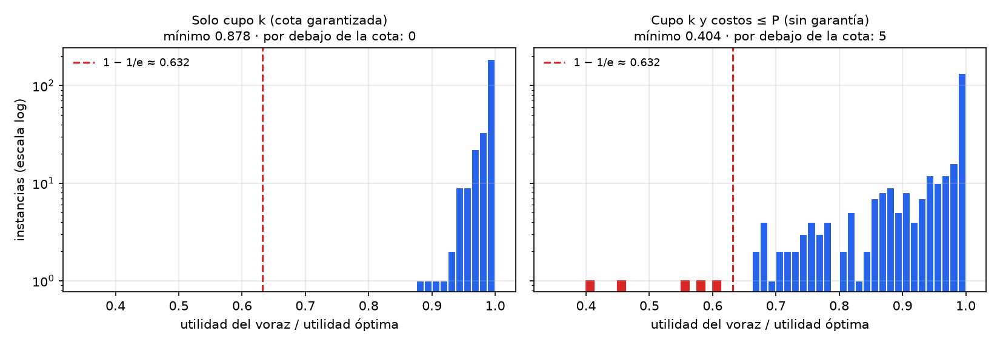

*Figura 12. Razón entre la utilidad del voraz y la óptima en 300 instancias propias; en rojo, las que quedan por debajo de 1 − 1/e.*

Sin costos ninguna instancia baja de 0,632, como garantiza el Teorema 3, y en la mayoría el voraz queda muy por encima. Con costos aparecen cinco instancias por debajo de la cota, la peor con 0,404 (Figura 12). Es la confirmación experimental de la sección 8.4: el voraz simple pierde su garantía cuando hay un límite de costos, y ese escenario necesita los algoritmos de cobertura con presupuesto de la variante de costos.

## 11. Resultados del caso de 15 nodos

### 11.1 Datos

El caso tiene N = 15 nodos, T = 3 rondas, k = 5, B = 30 y P = 24, un grafo completo con 105 aristas y Rᵢ = 18 para todos los nodos. Un dato curioso del grafo es que el peso de cada arista depende solo del nodo de mayor índice: por ejemplo, todas las aristas que llegan a N11 pesan 0,8 y todas las que llegan a N13 pesan 0,2.

### 11.2 Resumen por ronda

| Ronda | Participantes | Costo (≤ 24) | f(S) | Óptimo f(S) | U(x) | Tiempo (ms) |
|---|---|---|---|---|---|---|
| 1 | N11, N14, N09, N15, N13 | 23 | 145,58 | 145,58 | 88,56 | 0,16 |
| 2 | N11, N14, N09, N15, N13 | 23 | 145,58 | 145,58 | 88,56 | 0,14 |
| 3 | N11, N14, N09, N15, N13 | 23 | 145,58 | 145,58 | 85,61 | 0,13 |

En las tres rondas el voraz eligió los mismos cinco nodos, y ese grupo coincide con el óptimo de la fuerza bruta (4 944 grupos revisados por ronda). La utilidad conjunta total es 436,74 y la del reparto 262,74. Las 28 verificaciones se cumplen (9 por ronda y la del presupuesto total) y el caso completo se resuelve en menos de 1 ms.

### 11.3 Por qué se eligen esos nodos

La Figura 13 muestra, para cada participante, el peso de influencia sobre cada nodo, y en la última fila la probabilidad de que cada nodo quede influido por el grupo. Con estos cinco participantes todos los nodos quedan influidos con probabilidad de al menos 0,93, así que casi todo el valor posible de la red queda cubierto.

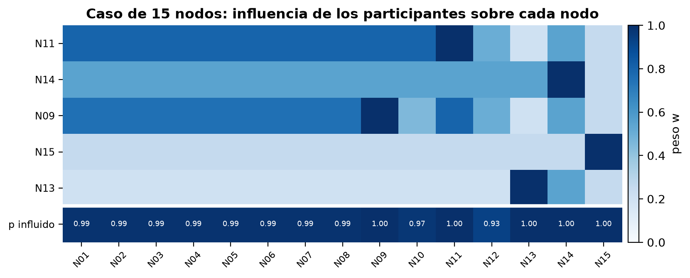

*Figura 13. Influencia de los participantes de la ronda 1 sobre cada nodo; la última fila es la probabilidad de quedar influido.*

### 11.4 Traza de la selección

| Paso | Nodo elegido | Ganancia Δ | f(S) acumulada | Candidatos evaluados | Costo acumulado |
|---|---|---|---|---|---|
| 1 | N11 | 103,49 | 103,49 | 15 | 4 |
| 2 | N14 | 24,28 | 127,77 | 14 | 7 |
| 3 | N09 | 9,93 | 137,70 | 13 | 10 |
| 4 | N15 | 5,53 | 143,23 | 12 | 16 |
| 5 | N13 | 2,35 | 145,58 | 11 | 23 |

Las ganancias bajan en cada paso, que es lo que predice el Lema 4. N11 entra primero porque todas las aristas que llegan a él pesan 0,8: su ganancia inicial es su propio a = 7,6 más la influencia sobre los otros catorce nodos. Los siguientes aportan cada vez menos porque la mayor parte de la red ya quedó influida. La Figura 14 muestra la misma traza.

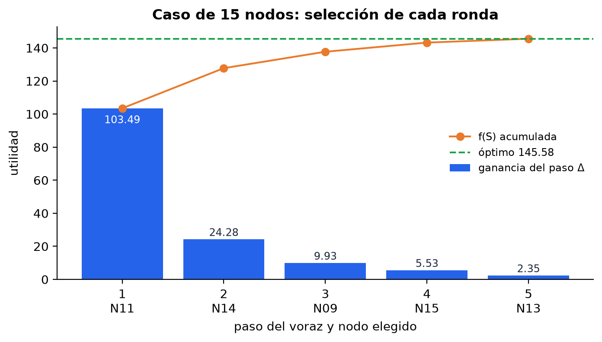

*Figura 14. Traza del voraz de selección en cada ronda: ganancia de cada paso, utilidad acumulada y óptimo.*

### 11.5 Reparto del presupuesto

| Nodo | Ronda 1 | Ronda 2 | Ronda 3 | Total (tope 18) |
|---|---|---|---|---|
| N11 | 5 | 5 | 8 | 18 |
| N14 | 7 | 7 | 4 | 18 |
| N09 | 7 | 7 | 4 | 18 |
| N15 | 6 | 6 | 6 | 18 |
| N13 | 5 | 5 | 8 | 18 |

En las dos primeras rondas el reparto es igual. En la tercera actúa el tope: a N14 y N09 solo les quedaban 4 unidades cada uno, así que el voraz les dio esas 4 (sus ganancias siguientes pasaron a valer 0, Lema 2) y entregó el resto a N11 y N13, que tenían las siguientes mejores ganancias. Por eso U(x) baja de 88,56 a 85,61 en la última ronda. Al final los cinco participantes gastaron exactamente su presupuesto total, como muestra la Figura 15.

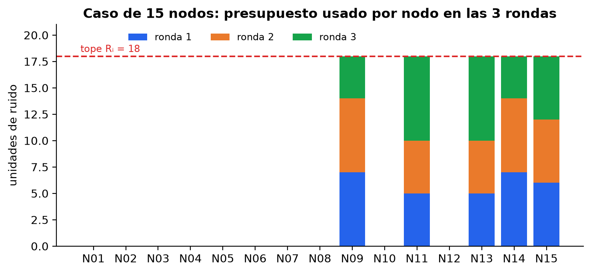

*Figura 15. Presupuesto de ruido usado por cada nodo en las tres rondas, con el tope Rᵢ = 18.*

## 12. Verificación de la implementación

Además del caso de la profesora, comprobamos la implementación con casos propios en tres niveles. Todos se generan con semilla fija, así que se pueden repetir con el mismo resultado.

1. **Contra métodos exactos.** En 300 instancias pequeñas el voraz de reparto coincide con la programación dinámica exacta de costo O(n·B²). El voraz de selección se compara contra la fuerza bruta: sin costos siempre cumple la cota (sección 10.3) y con costos nunca pasa el presupuesto.
2. **Contra las propiedades teóricas.** 1 500 pruebas aleatorias con la utilidad de influencia y 2 000 con la de cobertura confirman la monotonía y la submodularidad sin ninguna violación. El número de evaluaciones del voraz coincide exactamente con kN − k(k − 1)/2, y las comparaciones del montículo nunca pasan de 2n y 2·B·log₂ n.
3. **Contra las restricciones del problema.** Cada ejecución verifica las nueve restricciones de cada ronda y el presupuesto total por nodo (sección 9), y vuelve a calcular f y U desde la solución. Hay pruebas que meten a propósito soluciones inválidas para confirmar que la verificación las detecta, y casos con datos mal formados (pesos fuera de [0, 1], nodos inexistentes, coeficientes negativos) para confirmar que el lector los rechaza con un mensaje claro.

En total son 32 pruebas automáticas que corren en menos de un segundo. El manual técnico explica cómo ejecutarlas.

## 13. Alcance y variantes del proyecto

El enunciado define tres variantes obligatorias para la entrega final. Las planteamos aquí para dejar claro qué cubre esta entrega y qué falta.

**V1: costos de participación.** Es la Parte 2 con la restricción Σᵢ∈S cᵢ ≤ P. Los casos de prueba ya la traen y esta entrega la cumple como restricción, pero con el voraz simple, que no tiene garantía (secciones 8.4 y 10.3). Falta implementar los algoritmos de Khuller, Moss y Naor (1999), con garantías (1 − 1/e)/2 y (1 − 1/e), y deducir su T(n).

**V2: rondas con fallas.** Es el problema de T rondas de la sección 6, donde antes de cada ronda una parte de los nodos puede fallar y no estar disponible. El modelo natural es que cada nodo falla de forma independiente con probabilidad p, y el objetivo es maximizar la utilidad total esperada sumando las rondas. Esta entrega ya resuelve las T rondas con el tope de presupuesto por nodo, pero sin fallas y de forma miope.

**V3: nodos vecinos.** El presupuesto que recibe un nodo también mueve la utilidad de sus vecinos en el grafo. Un modelo posible es uᵢ(xᵢ + α·Σⱼ wᵢⱼ·xⱼ), con α ∈ [0, 1]. Con ese efecto la utilidad total deja de ser separable, así que el Teorema 1 ya no aplica tal cual: hay que estudiar si sigue siendo cóncava y si el voraz conserva la optimalidad o necesita otro algoritmo. En esta entrega el grafo solo se usa en la utilidad conjunta de la Parte 2, no en el reparto.

## 14. Síntesis

- **Parte 1:** es un problema de asignación de recursos separable y cóncavo. El voraz con montículo es óptimo (Teorema 1) y cuesta O(n + B log n), pseudo-polinomial en B.
- **Parte 2:** el problema de selección es NP-completo con una utilidad submodular general (reducción desde Cobertura Máxima) y también con la utilidad de influencia, que es monótona y submodular (Lema 4) (reducción desde Conjunto Dominante); ver el Teorema 2.
- **Aproximación:** el voraz de selección cuesta O(N²·k) y, con solo la restricción de cupo, garantiza al menos el 63,2 % del óptimo (Teorema 3), que es lo mejor posible para la clase general salvo que P = NP. Con el límite de costos esa garantía no aplica y el problema pasa a ser la variante de costos.
- **Validación:** los tiempos medidos siguen N + B log N en la Parte 1 y N²·k en la Parte 2, y los conteos de operaciones coinciden con la deducción. En 300 instancias propias el voraz nunca bajó de la cota sin costos, y con costos bajó en 5, lo que confirma que ahí la garantía se pierde.
- **Caso completo:** las T rondas se resuelven una por una en O(T·(N²·k + B log k)). En el caso de 15 nodos la solución coincidió con el óptimo en las tres rondas y cumplió las 28 restricciones.

## Referencias

- Cormen, T. H., Leiserson, C. E., Rivest, R. L. y Stein, C. (2009). Introduction to Algorithms (3.ª ed.). MIT Press.
- Feige, U. (1998). A threshold of ln n for approximating set cover. Journal of the ACM, 45(4), 634–652.
- Garey, M. R. y Johnson, D. S. (1979). Computers and Intractability: A Guide to the Theory of NP-Completeness. W. H. Freeman.
- Hochbaum, D. S. (1994). Lower and upper bounds for the allocation problem and other nonlinear optimization problems. Mathematics of Operations Research, 19(2), 390–409.
- Karp, R. M. (1972). Reducibility among combinatorial problems. En R. E. Miller y J. W. Thatcher (Eds.), Complexity of Computer Computations (pp. 85–103). Plenum Press.
- Khuller, S., Moss, A. y Naor, J. (1999). The budgeted maximum coverage problem. Information Processing Letters, 70(1), 39–45.
- Nemhauser, G. L., Wolsey, L. A. y Fisher, M. L. (1978). An analysis of approximations for maximizing submodular set functions—I. Mathematical Programming, 14(1), 265–294.
