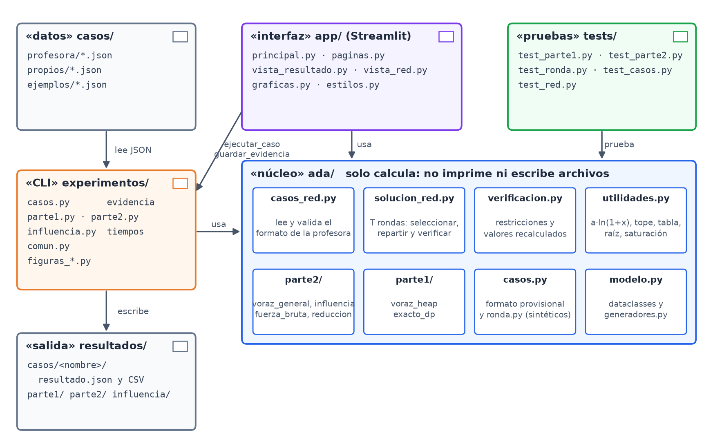
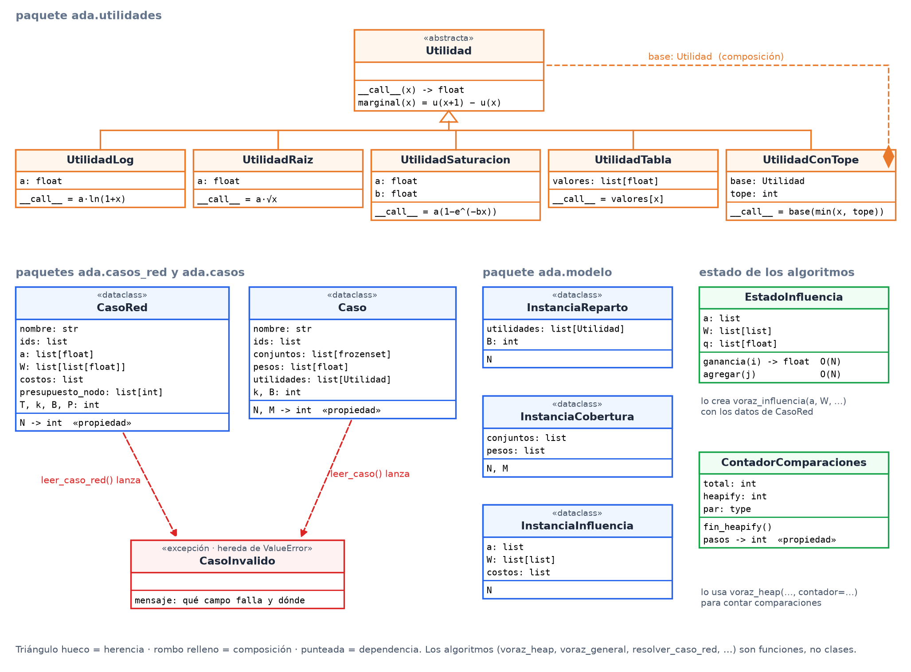
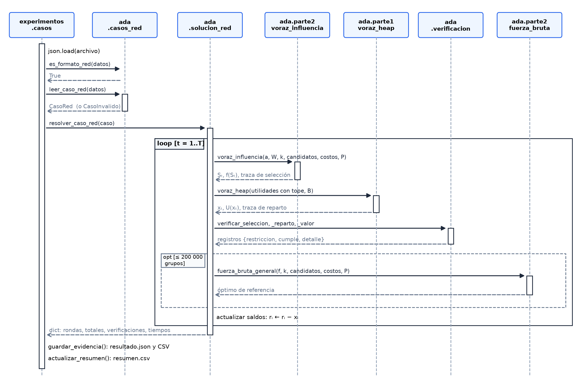
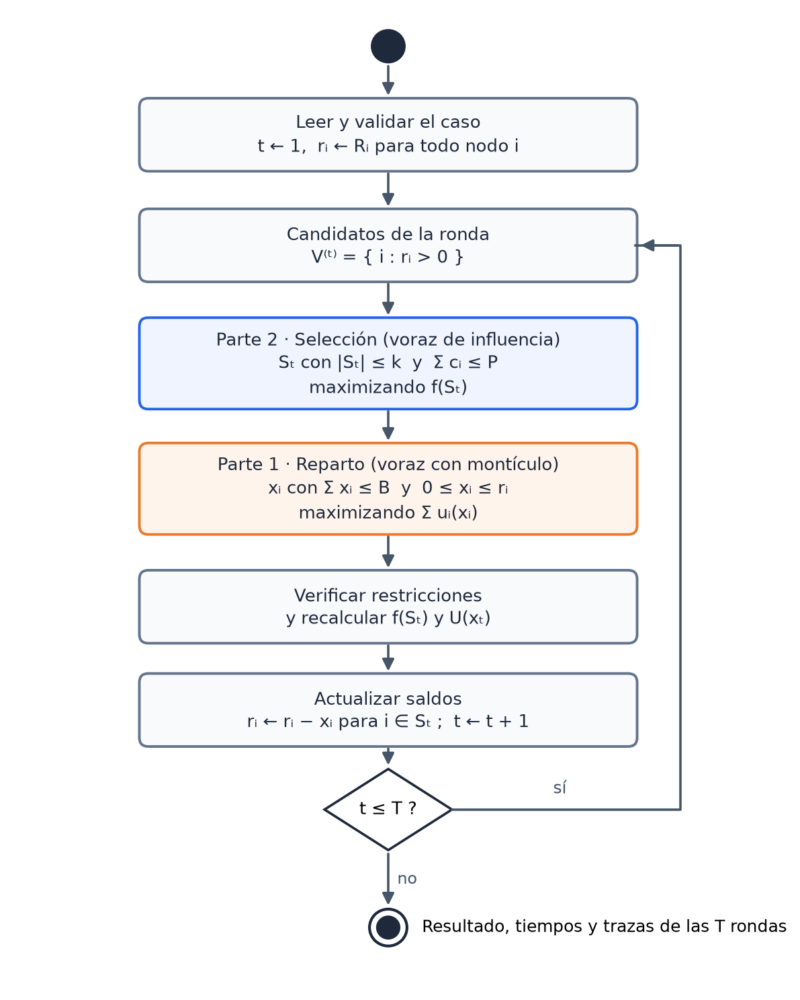
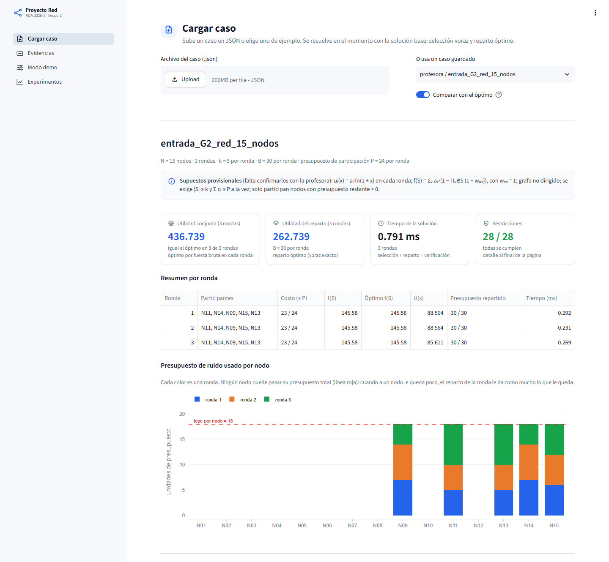
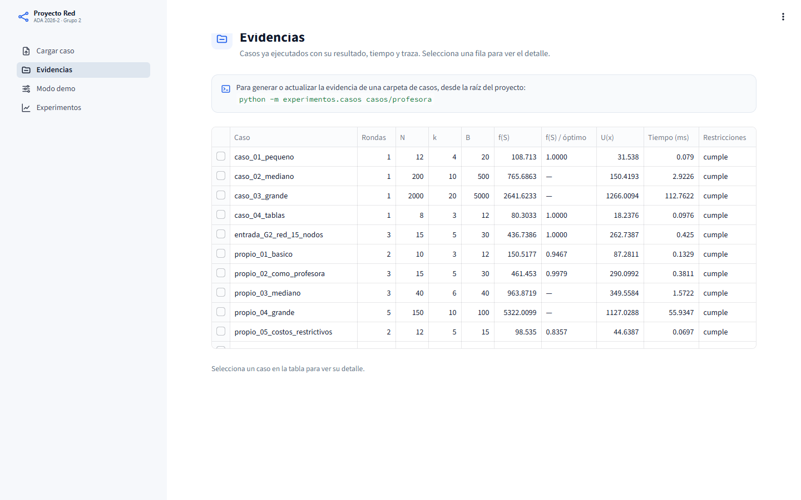

# Manual técnico — Proyecto Red (Grupo 2)

Análisis y Diseño de Algoritmos · Universidad de Caldas · Primera entrega

Las figuras se generan con `python -m experimentos.figuras_informe` y `python -m experimentos.figuras_manual`.

## 1. Propósito y alcance

Este manual explica cómo está construida la solución base del Proyecto Red y cómo se usa. Está pensado para que alguien que no escribió el código pueda instalarlo, ejecutarlo con cualquier caso de prueba, entender qué hace cada parte, interpretar los resultados y modificarlo sin romperlo.

Cubre la instalación, la arquitectura, el modelo de clases, el flujo de ejecución, la implementación de cada algoritmo (con su correspondencia con el documento de formulación), la referencia de las funciones públicas, los formatos de entrada y salida, la ejecución paso a paso, la interfaz visual, las pruebas y los casos propios, la reproducibilidad, cómo extender el código, sus limitaciones y la solución de problemas frecuentes.

La justificación matemática (demostraciones, reducciones y funciones de eficiencia) está en el documento de formulación del problema. Aquí se cita cuando hace falta, pero no se repite. El código está en el repositorio github.com/jgarciarf2/Proyecto-ADA-2026-II, y la versión que corresponde a esta entrega es la que tiene la etiqueta entrega-1.

## 2. Requisitos e instalación

### 2.1 Requisitos

| Componente | Versión | Para qué se usa |
|---|---|---|
| Python | 3.10 o más reciente (probado con 3.14) | Todo el proyecto |
| numpy | cualquiera reciente | Ajuste por mínimos cuadrados en los experimentos |
| matplotlib | cualquiera reciente | Gráficas de los experimentos y figuras de los documentos |
| pytest | cualquiera reciente | Pruebas automáticas |
| streamlit, plotly, pandas | solo para la interfaz visual | Interfaz en el navegador (archivo requirements-app.txt) |

Los algoritmos solo usan la biblioteca estándar de Python (heapq, itertools, math, random, dataclasses). numpy y matplotlib se usan únicamente para medir y graficar, así que la solución funciona aunque no estén instaladas.

### 2.2 Instalación

Desde la carpeta raíz del proyecto:

```text
python -m venv .venv
.venv\Scripts\activate                 (Windows)
source .venv/bin/activate              (Linux o macOS)
pip install -r requirements.txt
pip install -r requirements-app.txt     (solo si se va a usar la interfaz)
```

El entorno virtual .venv queda dentro del proyecto y está ignorado por git, así que no se sube al repositorio.

### 2.3 Comprobar la instalación

```text
python -m pytest
```

Debe terminar con el mensaje "35 passed" en alrededor de un segundo. Si alguna prueba falla, la instalación o el código no están en buen estado (ver la sección 16).

## 3. Arquitectura

### 3.1 Capas y reglas

El código está separado en tres capas con responsabilidades distintas:

- **ada/ (núcleo):** solo calcula. No imprime, no dibuja y no lee ni escribe archivos. Recibe datos en memoria y devuelve resultados en memoria. Así se puede probar de forma aislada y reutilizar desde la línea de comandos, las pruebas y la interfaz.
- **experimentos/ (línea de comandos):** lee archivos, llama al núcleo, mide tiempos, guarda resultados y dibuja gráficas.
- **app/ (interfaz):** solo presenta. Reutiliza las mismas funciones de experimentos/ para resolver y guardar casos, así que la interfaz y la línea de comandos producen exactamente los mismos resultados.

Las pruebas (tests/) verifican el núcleo, y los datos (casos/) y la salida (resultados/) son carpetas aparte. La Figura 1 muestra las dependencias entre las partes.



*Figura 1. Diagrama de componentes (UML): carpetas del proyecto y dependencias entre ellas.*

### 3.2 Estructura de carpetas

| Ruta | Contenido |
|---|---|
| ada/parte1/voraz.py | Voraz de reparto con montículo (voraz_heap) y contador de comparaciones |
| ada/parte1/dp.py | Programación dinámica exacta para el reparto (verificador) |
| ada/parte2/voraz.py | Voraz de selección genérico (voraz_general) y su versión de cobertura |
| ada/parte2/influencia.py | Utilidad de influencia, su estado incremental y su voraz |
| ada/parte2/cobertura.py | Utilidad de cobertura ponderada (casos sintéticos) |
| ada/parte2/fuerza_bruta.py | Óptimo exacto de la selección para casos pequeños |
| ada/parte2/reduccion.py | La reducción desde Cobertura Máxima, en código |
| ada/casos_red.py | Lector, validador y generador del formato de la profesora |
| ada/solucion_red.py | Solución base por rondas |
| ada/verificacion.py | Verificación de restricciones |
| ada/utilidades.py | Funciones de utilidad cóncavas |
| ada/casos.py, ada/ronda.py | Formato provisional de casos sintéticos y su solución de una ronda |
| ada/modelo.py, ada/generadores.py | Clases de datos e instancias sintéticas con semilla fija |
| experimentos/casos.py | Ejecuta casos y guarda la evidencia |
| experimentos/parte1.py, parte2.py, influencia.py | Miden tiempos contra la teoría y verifican la cota |
| experimentos/figuras_informe.py, figuras_manual.py | Figuras de los documentos |
| experimentos/comun.py | Medición con mediana, escritura de CSV y gráfica medido contra teórico |
| app/ | Interfaz en Streamlit |
| tests/ | 35 pruebas automáticas |
| casos/profesora/, casos/propios/, casos/ejemplos/ | Casos de prueba |
| resultados/ | Evidencia, tiempos y gráficas generadas |
| docs/ | Documentación en Markdown y figuras |

### 3.3 Decisiones de diseño

1. **Una sola versión de cada algoritmo.** El voraz de selección es una sola función, voraz_general, que recibe la utilidad como dos funciones: ganancia(i) y agregar(i). La utilidad de cobertura y la de influencia solo cambian esas dos funciones, así que cualquier corrección del algoritmo aplica a todas las utilidades a la vez.
2. **Lo opcional va por parámetros.** Contar operaciones (contador=, contar=) y registrar la traza (traza=) son parámetros opcionales del mismo algoritmo, no copias del código. Sin esos parámetros el algoritmo hace exactamente lo mismo.
3. **Los algoritmos reciben los datos sueltos**, igual que el pseudocódigo del documento: voraz_heap(utilidades, B), voraz_influencia(a, W, k, …). Las clases de datos sirven para leer y transportar casos, no para los algoritmos.
4. **Cálculo separado de los archivos.** Como el núcleo no escribe archivos, la evidencia sale de una sola función (guardar_evidencia), y el mismo resultado se puede mostrar en la interfaz sin volver a calcularlo.
5. **Semillas fijas.** Todos los datos sintéticos salen de generadores con semilla, así que cualquier resultado se puede repetir exactamente.
6. **Supuestos en un solo lugar.** Las fórmulas que la profesora no definió (la utilidad del reparto y la conjunta) están en ada/solucion_red.py y ada/parte2/influencia.py. Cambiarlas no requiere tocar los algoritmos.

## 4. Modelo de clases

La Figura 2 muestra las clases del núcleo. Los algoritmos son funciones; las clases representan datos (casos e instancias), funciones de utilidad y el estado interno que algunos algoritmos necesitan.



*Figura 2. Diagrama de clases (UML) del paquete ada.*

| Clase | Archivo | Responsabilidad |
|---|---|---|
| Utilidad | ada/utilidades.py | Clase base abstracta: u(x) y su ganancia marginal u(x+1) − u(x) |
| UtilidadLog | ada/utilidades.py | a·ln(1+x), la utilidad que usamos para los casos de la profesora |
| UtilidadConTope | ada/utilidades.py | Envuelve otra utilidad y la deja constante después de un tope (el saldo del nodo) |
| UtilidadRaiz, UtilidadSaturacion, UtilidadTabla | ada/utilidades.py | Otras familias cóncavas, usadas en casos sintéticos |
| CasoRed | ada/casos_red.py | Un caso de la profesora ya validado: ids, a, W, costos, presupuestos, T, k, B, P |
| Caso | ada/casos.py | Un caso del formato provisional |
| CasoInvalido | ada/casos.py | Excepción con un mensaje que dice qué campo está mal |
| EstadoInfluencia | ada/parte2/influencia.py | Guarda qᵥ para calcular la ganancia de influencia en O(N) |
| ContadorComparaciones | ada/parte1/voraz.py | Cuenta las comparaciones del montículo para validar T(n) |
| InstanciaReparto, InstanciaCobertura, InstanciaInfluencia | ada/modelo.py | Instancias sintéticas de los experimentos |

Todas las utilidades heredan de Utilidad e implementan __call__. La ganancia marginal la da la clase base, así que una utilidad nueva solo necesita su fórmula. UtilidadConTope es una composición: contiene otra utilidad y le aplica el tope, lo que permite combinar cualquier fórmula con el presupuesto que le queda a un nodo.

## 5. Flujo de ejecución

### 5.1 De un archivo de caso a la evidencia

La Figura 3 muestra la secuencia de llamadas al ejecutar python -m experimentos.casos casos/profesora:

1. experimentos.casos lee el archivo JSON y pregunta con es_formato_red si es del formato de la profesora.
2. leer_caso_red valida todos los campos y construye un CasoRed. Si algo está mal, lanza CasoInvalido con un mensaje claro y el caso no se ejecuta.
3. resolver_caso_red repite, para cada ronda: calcular los candidatos (nodos con saldo), elegir los participantes con voraz_influencia, repartir el presupuesto con voraz_heap, verificar todas las restricciones, calcular el óptimo de referencia si el caso es pequeño y actualizar los saldos.
4. El resultado vuelve como un diccionario. guardar_evidencia lo escribe como resultado.json y como archivos CSV, y actualizar_resumen agrega la fila del caso a resumen.csv.



*Figura 3. Diagrama de secuencia (UML) de la ejecución de un caso de la profesora.*

### 5.2 Dentro de una ronda

La Figura 4 es el diagrama de actividades de la solución completa. La selección (Parte 2) siempre se resuelve antes del reparto (Parte 1), porque el reparto solo tiene sentido entre los nodos elegidos.



*Figura 4. Diagrama de actividades (UML) de una ejecución de T rondas.*

## 6. Implementación de los algoritmos

### 6.1 Voraz de reparto (Parte 1)

Archivo ada/parte1/voraz.py, función voraz_heap(utilidades, B, contador=None, traza=None). Recibe la lista de utilidades de los participantes (ya con su tope) y el presupuesto B, y devuelve (x, U): las unidades de cada participante y la utilidad total. Es la implementación directa del algoritmo VORAZ-REPARTO del documento; los comentarios señalan la línea del pseudocódigo:

```text
heap = [par((-u.marginal(0), i)) for i, u in enumerate(utilidades)]   # línea 2: ganancias iniciales
heapq.heapify(heap)                                                  # montículo en O(n)
for unidad in range(1, B + 1 if heap else 1):                        # línea 3: B iteraciones
    neg_g, i = heap[0]                                               # línea 4: mayor ganancia
    if -neg_g <= 0:                                                  # línea 5: nadie gana más
        break
    x[i] += 1                                                        # línea 6
    heapq.heapreplace(heap, par((-utilidades[i].marginal(x[i]), i)))  # línea 7: O(log n)
```

Detalles de la implementación:

- heapq es un montículo de mínimos, así que se guarda la ganancia con signo negativo para tener la mayor arriba.
- Los empates se resuelven por el índice del nodo, porque los pares (ganancia, i) se comparan en ese orden. Eso hace que el resultado sea determinista.
- Si no hay participantes (lista vacía), el ciclo no se ejecuta y el resultado es x = [] y U = 0.
- Con contador=ContadorComparaciones() los pares son tuplas que cuentan cada comparación; después de la ejecución, contador.heapify y contador.pasos tienen las comparaciones de cada fase.
- Con traza=[] se agrega un registro por unidad entregada: {unidad, nodo, ganancia_marginal}.

Costo: O(n + B log n), como se deduce en la sección 4.9 del documento de formulación.

### 6.2 Voraz de selección (Parte 2)

Archivo ada/parte2/voraz.py, función voraz_general(N, k, ganancia, agregar, candidatos=None, costos=None, presupuesto=None, contar=False, traza=None). Es el algoritmo VORAZ-SELECCIÓN del documento, escrito sin depender de la utilidad. Este es el núcleo del ciclo (fragmento simplificado: el código real además cuenta evaluaciones y registra la traza):

```text
restantes = set(candidatos)
for paso in range(min(k, len(restantes))):
    mejor, mejor_g = None, -1.0
    for i in restantes:
        if costos is not None and gastado + costos[i] > presupuesto:
            continue                                   # no cabe en P
        g = ganancia(i)                                # Δᵢ(S), costo τ
        if g > mejor_g or (g == mejor_g and i < mejor):
            mejor, mejor_g = i, g
    if mejor is None:
        break                                          # ningún candidato cabe
    elegidos.append(mejor); restantes.remove(mejor); agregar(mejor)
```

El contrato de las dos funciones que recibe es simple: ganancia(i) devuelve f(S ∪ {i}) − f(S) para el grupo actual, y agregar(i) actualiza el estado interno de la utilidad cuando i entra al grupo. Con contar=True devuelve además el número de evaluaciones de la ganancia, que la teoría predice exactamente (kN − k(k−1)/2 sin costos). Con traza=[] agrega un registro por paso: {paso, nodo, ganancia_marginal, utilidad_acumulada, candidatos_evaluados} y, si hay costos, costo_acumulado.

### 6.3 Utilidad de influencia

Archivo ada/parte2/influencia.py. matriz_influencia(N, aristas) arma la matriz simétrica W con wᵥᵥ = 1. f_influencia(S, a, W) calcula la utilidad desde cero en O(N·│S│) y se usa para verificar. La clase EstadoInfluencia es la que usa el voraz: guarda qᵥ, la probabilidad de que v todavía no esté influido, y aplica las dos fórmulas de la sección 5.6 del documento:

$$
\Delta_i(S) = \sum_{v} a_v \, q_v \, w_{iv}, \qquad q_v \leftarrow q_v \,(1 - w_{jv}) \;\text{ al agregar } j
$$

Cada una cuesta O(N). voraz_influencia(a, W, k, …) crea el estado y llama a voraz_general con estado.ganancia y estado.agregar. Costo total: O(N²·k).

### 6.4 Fuerza bruta y límite de tamaño

Archivo ada/parte2/fuerza_bruta.py. fuerza_bruta_general(valor, k, candidatos, costos=None, presupuesto=None) prueba todos los grupos de 1 a k candidatos que cumplen el límite de costos y devuelve el de mayor utilidad. subconjuntos_a_probar(n, k) cuenta cuántos grupos revisaría: Σⱼ≤ₖ C(n, j). La solución solo calcula el óptimo de referencia cuando ese número es a lo sumo 200 000 (constante LIMITE_FUERZA_BRUTA de ada/solucion_red.py). Por ejemplo, con n = 15 y k = 5 son 4 944 grupos y sí se calcula; con n = 40 y k = 6 son 4 598 479 y no se calcula.

### 6.5 Programación dinámica (verificador)

Archivo ada/parte1/dp.py, función exacto_dp(utilidades, B). Calcula el reparto óptimo con la recurrencia mejorᵢ[b] = máx₀≤ₜ≤ᵦ (mejorᵢ₋₁[b − t] + uᵢ(t)), en O(n·B²). No supone concavidad, por eso sirve de juez imparcial para comprobar que el voraz es óptimo. Solo se usa en pruebas y en casos pequeños.

### 6.6 Verificación de restricciones

Archivo ada/verificacion.py. Cada función devuelve una lista de registros {restriccion, cumple, detalle} que van directo a la evidencia:

| Función | Revisa |
|---|---|
| verificar_seleccion(S, N, k) | │S│ ≤ k, que no haya nodos repetidos y que todos los nodos existan |
| verificar_reparto(x, B) | Σ xᵢ ≤ B y que cada xᵢ sea un entero mayor o igual que 0 |
| verificar_valor(nombre, reportado, recalculado) | Que el valor que devolvió el algoritmo coincida con el recalculado desde la solución (tolerancia 10⁻⁹) |
| todas_cumplen(lista) | Si todos los registros se cumplen |

resolver_caso_red agrega dos más por ronda (Σ cᵢ ≤ P y xᵢ ≤ saldo del nodo) y una global (ningún nodo pasa su presupuesto total). En total son 9 por ronda más 1.

### 6.7 Solución por rondas

Archivo ada/solucion_red.py, función resolver_caso_red(caso, con_optimo=True). Para cada ronda calcula los saldos rᵢ = Rᵢ − usadoᵢ, toma como candidatos los nodos con rᵢ > 0, construye para cada participante la utilidad UtilidadConTope(UtilidadLog(aᵢ), rᵢ) y mide por separado el tiempo de la selección y el del reparto con time.perf_counter. Devuelve un diccionario con una entrada por ronda, los totales, el presupuesto usado por nodo, las verificaciones, los tiempos y la lista de supuestos. Costo: O(T·(N²·k + B log k)).

### 6.8 Correspondencia con el documento de formulación

| Documento | Código | Prueba que lo comprueba |
|---|---|---|
| Algoritmo VORAZ-REPARTO y Teorema 1 | voraz_heap | test_voraz_igual_al_optimo_dp (300 casos contra la DP) |
| Lema 2 (el tope conserva la concavidad) | UtilidadConTope | test_ronda_cumple_restricciones_y_reparte_optimo |
| T(n, B) y costo del heapify | ContadorComparaciones | test_contador_no_cambia_el_resultado_y_respeta_cotas |
| Utilidad de influencia y Lema 4 | f_influencia, EstadoInfluencia | test_influencia_es_monotona_y_submodular |
| Algoritmo VORAZ-SELECCIÓN y E(N, k) | voraz_general, voraz_influencia | test_generador_de_influencia_y_conteo_de_evaluaciones |
| Teorema 3 (cota 1 − 1/e) | voraz_influencia | test_voraz_sin_costos_respeta_la_cota |
| Reducción desde Cobertura Máxima | reducir_desde_cobertura_maxima | test_ejemplo_de_la_reduccion |
| Algoritmo RESOLVER-CASO | resolver_caso_red | test_caso_de_la_profesora_cumple_todo, test_casos_limite |

## 7. Referencia de funciones públicas

### 7.1 ada/casos_red.py

| Función | Parámetros | Devuelve | Costo |
|---|---|---|---|
| es_formato_red(datos) | Diccionario leído del JSON | True si tiene "parametros" y "grafo" | O(1) |
| leer_caso_red(datos, nombre="caso") | Diccionario del caso | CasoRed, o lanza CasoInvalido | O(N² + │E│) |
| caso_red_sintetico(nombre, N, T, k, B, P, R=18, densidad=1.0, costos=(2, 7), semilla=0) | Parámetros del caso; R puede ser un número o una lista | Diccionario en el formato de la profesora | O(N²) |

### 7.2 ada/solucion_red.py

| Función | Parámetros | Devuelve | Costo |
|---|---|---|---|
| resolver_caso_red(caso, con_optimo=True) | CasoRed; si se calcula el óptimo de referencia | Diccionario con rondas, totales, verificaciones y tiempos (sección 9.2) | O(T·(N²·k + B log k)) |

### 7.3 ada/parte1 y ada/parte2

| Función | Parámetros | Devuelve | Costo |
|---|---|---|---|
| voraz_heap(utilidades, B, contador=None, traza=None) | Lista de Utilidad, presupuesto | (x, U) | O(n + B log n) |
| exacto_dp(utilidades, B) | Lista de Utilidad, presupuesto | (x, U) óptimos | O(n·B²) |
| voraz_general(N, k, ganancia, agregar, candidatos, costos, presupuesto, contar, traza) | Funciones de la utilidad y restricciones | (elegidos, valor) y, con contar, las evaluaciones | O(n·k·τ) |
| voraz_influencia(a, W, k, candidatos, costos, presupuesto, contar, traza) | Coeficientes, matriz, cupo y restricciones | (elegidos, valor) | O(N²·k) |
| f_influencia(S, a, W) | Grupo, coeficientes, matriz | f(S) | O(N·│S│) |
| matriz_influencia(N, aristas) | Lista de (u, v, w) con índices | Matriz W simétrica con diagonal 1 | O(N² + │E│) |
| fuerza_bruta_general(valor, k, candidatos, costos, presupuesto) | Función f, cupo, restricciones | (mejor grupo, valor) | O(Σⱼ≤ₖ C(n, j)·τ_f) |
| subconjuntos_a_probar(n, k) | Tamaños | Σⱼ≤ₖ C(n, j) | O(k) |
| voraz_submodular(conjuntos, pesos, k, contar, traza) | Utilidad de cobertura | (elegidos, valor) | O(N·k·d) |
| reducir_desde_cobertura_maxima(universo, subconjuntos, k, t) | Instancia de Cobertura Máxima | (conjuntos, pesos, k, t) | O(│U│ + Σ│Sᵢ│) |

### 7.4 experimentos/casos.py

| Función | Qué hace |
|---|---|
| ejecutar_caso(datos, con_optimo=True) | Reconoce el formato, lee y valida el caso, lo resuelve y devuelve el resultado serializable |
| guardar_evidencia(datos, res, salida) | Escribe resultado.json y los CSV en la carpeta salida |
| fila_resumen(res) | Una fila con las columnas de resumen.csv (las mismas para los dos formatos) |
| actualizar_resumen(base) | Rehace resumen.csv con todos los casos guardados |
| generar_ejemplos(), generar_propios() | Crean los casos de casos/ejemplos y casos/propios |

## 8. Formato de entrada

### 8.1 Estructura

Un caso es un archivo JSON con tres bloques: "parametros", "grafo" y "nodos". El nombre del caso es el nombre del archivo, salvo que el JSON traiga un campo "nombre". Este es un caso mínimo completo y válido, con tres nodos y una ronda:

```text
{
  "parametros": {
    "numero_nodos": 3,
    "numero_rondas": 1,
    "cupo_participantes_por_ronda_k": 2,
    "presupuesto_ruido_por_ronda_B": 6,
    "presupuesto_costos_participacion_por_ronda": 5
  },
  "grafo": [
    { "u": "A", "v": "B", "peso_influencia": 0.5 },
    { "u": "B", "v": "C", "peso_influencia": 0.3 }
  ],
  "nodos": [
    { "id": "A", "coeficiente_utilidad": 8.0, "presupuesto_total_nodo": 10, "costo_participacion": 2 },
    { "id": "B", "coeficiente_utilidad": 5.0, "presupuesto_total_nodo": 10, "costo_participacion": 4 },
    { "id": "C", "coeficiente_utilidad": 6.0, "presupuesto_total_nodo": 10, "costo_participacion": 3 }
  ]
}
```

### 8.2 Campos y validaciones

| Campo | Significado | Regla que se valida |
|---|---|---|
| parametros.numero_nodos | N | Entero ≥ 0 e igual a la cantidad de nodos listados |
| parametros.numero_rondas | T | Entero ≥ 1 |
| parametros.cupo_participantes_por_ronda_k | k | Entero ≥ 1 |
| parametros.presupuesto_ruido_por_ronda_B | B | Entero ≥ 0 |
| parametros.presupuesto_costos_participacion_por_ronda | P | Entero ≥ 0 |
| grafo[].u, grafo[].v | Extremos de la arista | Ids de nodos existentes y distintos entre sí |
| grafo[].peso_influencia | wᵤᵥ | Número entre 0 y 1 |
| nodos[].id | Identificador | Obligatorio y sin repetir; puede ser texto o número |
| nodos[].coeficiente_utilidad | aᵢ | Número > 0 |
| nodos[].presupuesto_total_nodo | Rᵢ | Entero ≥ 0 |
| nodos[].costo_participacion | cᵢ | Número ≥ 0 |

El grafo puede tener cualquier cantidad de aristas, desde ninguna hasta todas. Cada arista se lee como no dirigida, así que basta escribirla una vez. Los pares que no aparecen tienen peso 0.

### 8.3 Mensajes de error

Si el caso no cumple una regla, leer_caso_red lanza CasoInvalido y el programa muestra uno de estos mensajes. La interfaz los muestra en un recuadro de error.

| Mensaje | Causa |
|---|---|
| parametros.<campo> debe ser un entero >= 0 | Falta un parámetro o no es un entero no negativo |
| k y numero_rondas deben ser >= 1 | Cupo o número de rondas en 0 |
| numero_nodos = N pero hay M nodos | La cantidad declarada no coincide con la lista |
| todos los nodos necesitan un 'id' distinto | Falta un id o hay ids repetidos |
| nodo X: coeficiente_utilidad debe ser > 0 | Coeficiente negativo, cero o no numérico |
| nodo X: costo_participacion debe ser >= 0 | Costo negativo o no numérico |
| nodo X: presupuesto_total_nodo debe ser un entero >= 0 | Presupuesto negativo o con decimales |
| arista U-V: nodo desconocido | La arista menciona un id que no está en la lista de nodos |
| arista U-V: no puede unir un nodo consigo mismo | u y v son el mismo nodo |
| arista U-V: peso_influencia debe estar entre 0 y 1 | Peso fuera de [0, 1] |

### 8.4 Formato provisional

El programa también acepta un segundo formato, con nodos que cubren "tipos de datos" con pesos, que usamos para generar casos sintéticos antes de recibir los de la profesora. Se reconoce porque no tiene el bloque "parametros", y está documentado al inicio de ada/casos.py.

## 9. Formato de salida

### 9.1 Archivos

Por cada caso se crea la carpeta resultados/casos/<nombre del caso>/:

| Archivo | Contenido |
|---|---|
| resultado.json | El caso de entrada completo ("entrada") y el resultado ("resultado") |
| traza_seleccion.csv | Una fila por paso del voraz de selección, en todas las rondas |
| traza_reparto.csv | Una fila por unidad de ruido entregada, en todas las rondas |
| reparto.csv | Una fila por participante y ronda |
| verificacion.csv | Una fila por restricción revisada |

Además, resultados/casos/resumen.csv tiene una fila por cada caso guardado en la carpeta, no solo por los de la última ejecución.

### 9.2 Estructura de resultado.json

| Clave | Tipo | Contenido |
|---|---|---|
| formato | Texto | "red" para el formato de la profesora |
| caso, N, T, k, B, P | Texto y enteros | Nombre y parámetros del caso |
| rondas | Lista | Una entrada por ronda (tabla siguiente) |
| utilidad_conjunta_total, utilidad_reparto_total | Número | Suma de f(Sₜ) y de U(xₜ) en las T rondas |
| presupuesto_usado | Lista | Por nodo: {nodo, usado, tope} |
| verificacion_global | Lista | La restricción de presupuesto total por nodo |
| cumple_todo | Booleano | True si se cumplen todas las restricciones de todas las rondas |
| tiempo_s | Objeto | {total} en segundos |
| supuestos | Lista de texto | Las fórmulas supuestas (sección 2.2 del documento de formulación) |

| Clave de cada ronda | Contenido |
|---|---|
| ronda, candidatos | Número de ronda y nodos que tenían saldo |
| seleccion, costo_participacion | Participantes elegidos y su costo total |
| utilidad_conjunta, optimo | f(Sₜ) y, si se calculó, {valor, seleccion, metodo} del óptimo |
| reparto, utilidad_reparto | Por participante {nodo, unidades, utilidad, ultima_ganancia, restante_antes} y U(xₜ) |
| verificaciones, cumple_todo | Las 9 restricciones de la ronda y si todas se cumplen |
| tiempo_s | {seleccion, reparto, total} en segundos |
| traza_seleccion, traza_reparto | Los pasos de los dos voraces |

### 9.3 Columnas de los CSV

| Archivo | Columnas |
|---|---|
| traza_seleccion.csv | ronda, paso, nodo, ganancia_marginal, utilidad_acumulada, candidatos_evaluados, costo_acumulado |
| traza_reparto.csv | ronda, unidad, nodo, ganancia_marginal |
| reparto.csv | ronda, nodo, unidades, utilidad, ultima_ganancia, restante_antes |
| verificacion.csv | restriccion, cumple, detalle |
| resumen.csv | caso, rondas, N, k, B, f(S), optimo_f, U(x), t_seleccion_ms, t_reparto_ms, t_total_ms, cumple_restricciones |

Si una ronda no tiene participantes (por ejemplo, porque ningún costo cabe en P), sus archivos quedan con el encabezado y sin filas para esa ronda. En resumen.csv, optimo_f queda vacío cuando el caso es demasiado grande para la fuerza bruta.

## 10. Ejecución paso a paso

### 10.1 Comandos

| Comando | Qué hace | Tiempo aproximado |
|---|---|---|
| python -m pytest | Corre las 35 pruebas de correctitud | 1 s |
| python -m experimentos.casos casos/profesora | Resuelve los casos de la profesora y guarda la evidencia | 1 s |
| python -m experimentos.casos casos/propios | Resuelve los 10 casos propios | 1 s |
| python -m experimentos.casos ruta/al/caso.json | Resuelve un caso puntual | 1 s |
| python -m experimentos.casos --sin-optimo casos/propios | Igual, sin calcular el óptimo de referencia | 1 s |
| python -m experimentos.casos --generar-ejemplos | Vuelve a crear casos/ejemplos y casos/propios | 1 s |
| python -m experimentos.parte1 | Tiempos del reparto contra la teoría y conteo de comparaciones | 2 min |
| python -m experimentos.parte2 | Tiempos de la selección con utilidad de cobertura | 20 s |
| python -m experimentos.influencia | Tiempos del voraz de influencia y verificación de la cota | 1 min |
| python -m experimentos.figuras_informe | Figuras del documento de formulación | 10 s |
| python -m experimentos.figuras_manual | Diagramas UML de este manual | 5 s |
| streamlit run app/principal.py | Abre la interfaz visual en el navegador | — |

Todos los comandos se ejecutan desde la carpeta raíz del proyecto y con el entorno virtual activado.

### 10.2 Resolver los casos de la profesora

Los casos se guardan en casos/profesora/ y se ejecuta python -m experimentos.casos casos/profesora. La consola muestra una línea por caso con su tamaño, las utilidades totales, el tiempo y si cumple todas las restricciones:

```text
  entrada_G2_red_15_nodos N=   15 k=  5 B=    30  f(S)=   436.739  U(x)=  262.739  t=    0.417 ms  cumple
Evidencia de 1 casos en ...\resultados\casos (resumen.csv con 15 casos guardados)
```

Si un caso tiene un error de formato, la ejecución se detiene con el mensaje de CasoInvalido que indica el campo. Para los casos privados de la profesora el procedimiento es el mismo: copiarlos a una carpeta y pasar esa carpeta al comando.

## 11. Interfaz visual

Se abre con streamlit run app/principal.py y queda disponible en http://localhost:8501. Tiene cuatro secciones en la barra lateral:

- **Cargar caso:** se sube un JSON o se elige uno guardado (primero los de la profesora, luego los propios y los de ejemplo). El caso se resuelve en el momento y se puede guardar como evidencia con el mismo resultado que da la línea de comandos.
- **Evidencias:** tabla con todos los casos de resultados/casos; al seleccionar una fila se ve su detalle.
- **Modo demo:** casos sintéticos con controles para N, k, M, d, B y la semilla, pensado para explicar los algoritmos en vivo.
- **Experimentos:** las gráficas de tiempo medido contra la teoría.

Para un caso de la profesora la vista muestra los supuestos, las métricas totales, el resumen por ronda y el presupuesto usado por cada nodo contra su tope. Para la ronda elegida muestra además la selección paso a paso, el mapa de influencia de los participantes, el reparto como nivel de agua, las trazas en tablas y la verificación de cada restricción. La Figura 5 muestra esa vista con el caso de 15 nodos y la Figura 6 la tabla de evidencias.



*Figura 5. Interfaz: vista del caso de 15 nodos de la profesora.*



*Figura 6. Interfaz: tabla de evidencias con todos los casos ejecutados.*

## 12. Pruebas y casos propios

### 12.1 Pruebas automáticas

Las 35 pruebas se ejecutan con python -m pytest. Están agrupadas por archivo:

| Archivo | Pruebas | Qué comprueban |
|---|---|---|
| tests/test_parte1.py | 4 | Voraz igual a la DP en 300 casos, que el reparto gaste B, que el contador no cambie el resultado y respete las cotas 2n y 2·B·log₂ n, y que sin concavidad el voraz falla (contraejemplo) |
| tests/test_parte2.py | 4 | Monotonía y submodularidad de la cobertura (2 000 pruebas), cota (1 − 1/e) en 200 casos, fórmula exacta de evaluaciones y el ejemplo de la reducción |
| tests/test_ronda.py | 5 | Que las trazas coincidan con los resultados, que la traza no cambie el resultado, que la verificación detecte soluciones inválidas y que la ronda reparta de forma óptima |
| tests/test_casos.py | 9 | Lectura del formato provisional, rechazo de 6 tipos de caso inválido y ejecución completa de un caso |
| tests/test_red.py | 13 | Submodularidad de la influencia (1 500 pruebas), cota sin costos, presupuesto con costos, el caso de la profesora, rechazo de 4 tipos de caso inválido, el generador, los 10 casos propios, los casos límite y el reparto sin participantes |

### 12.2 Casos propios

El monitor indicó que cada grupo debe crear sus propios casos de prueba a partir del de la profesora. Hicimos diez, en el mismo formato, cada uno pensado para probar una situación distinta. Se generan con semilla fija (python -m experimentos.casos --generar-ejemplos) y están en casos/propios/:

| Caso | N | T | k | B | P | Qué prueba |
|---|---|---|---|---|---|---|
| propio_01_basico | 10 | 2 | 3 | 12 | 10 | Caso pequeño y disperso, con óptimo en todas las rondas |
| propio_02_como_profesora | 15 | 3 | 5 | 30 | 24 | Mismos parámetros que el de la profesora, con otros datos |
| propio_03_mediano | 40 | 3 | 6 | 40 | 20 | Tamaño intermedio; ya no se calcula el óptimo |
| propio_04_grande | 150 | 5 | 10 | 100 | 40 | Tamaño grande |
| propio_05_costos_restrictivos | 12 | 2 | 5 | 15 | 6 | El límite de costos deja elegir menos de k nodos |
| propio_06_tope_agotado | 8 | 4 | 3 | 20 | 30 | Los nodos agotan su presupuesto y cambian los participantes |
| propio_07_sin_aristas | 10 | 2 | 4 | 10 | 20 | Grafo vacío: la utilidad conjunta es la suma de coeficientes |
| propio_08_presupuesto_cero | 8 | 2 | 3 | 0 | 15 | B = 0: hay participantes, pero no se reparte nada |
| propio_09_nadie_cabe | 6 | 2 | 3 | 10 | 1 | Ningún costo cabe en P: rondas sin participantes |
| propio_10_presupuestos_distintos | 10 | 3 | 4 | 20 | 20 | Presupuestos de 0 a 18; el nodo con 0 nunca participa |

Todos cumplen las restricciones. La razón es la utilidad conjunta total dividida por el óptimo total, cuando se pudo calcular:

| Caso | f(S) total | f(S) / óptimo | U(x) total | Tiempo (ms) |
|---|---|---|---|---|
| entrada_G2_red_15_nodos (profesora) | 436,74 | 1,000 | 262,74 | 0,42 |
| propio_01_basico | 150,52 | 0,947 | 87,28 | 0,13 |
| propio_02_como_profesora | 461,45 | 0,998 | 290,10 | 0,40 |
| propio_03_mediano | 963,87 | — | 349,56 | 1,42 |
| propio_04_grande | 5 322,01 | — | 1 127,03 | 58,61 |
| propio_05_costos_restrictivos | 98,54 | 0,836 | 44,64 | 0,08 |
| propio_06_tope_agotado | 174,63 | 1,000 | 144,97 | 0,13 |
| propio_07_sin_aristas | 65,40 | 1,000 | 81,57 | 0,14 |
| propio_08_presupuesto_cero | 82,41 | 0,889 | 0,00 | 0,06 |
| propio_09_nadie_cabe | 0,00 | 1,000 | 0,00 | 0,01 |
| propio_10_presupuestos_distintos | 265,09 | 0,991 | 204,41 | 0,20 |

Las razones menores que 1 aparecen en los casos donde el límite de costos restringe la selección, lo que coincide con el análisis del documento de formulación: con costos, el voraz simple no tiene garantía.

### 12.3 Errores que encontraron los casos propios

Los casos límite cumplieron su objetivo: encontraron tres errores que el caso de la profesora no habría mostrado. Los tres están corregidos y cubiertos por pruebas.

1. **Reparto sin participantes.** Si en una ronda nadie podía participar, voraz_heap intentaba leer la raíz de un montículo vacío y fallaba. Ahora el ciclo no se ejecuta cuando no hay participantes (prueba test_reparto_sin_participantes_no_falla).
2. **Evidencia vacía.** Con una ronda sin participantes, escribir el CSV de la traza fallaba porque no había filas de donde sacar el encabezado. Ahora los CSV tienen columnas fijas y se escriben con encabezado aunque estén vacíos.
3. **División por cero en la interfaz.** Con óptimo 0, la tabla de evidencias dividía por cero al calcular f(S)/óptimo. Ahora muestra 1 si los dos valores son 0, y "—" si no hay óptimo.

## 13. Reproducibilidad

- **Los resultados de los casos son deterministas.** El mismo caso da siempre la misma selección, el mismo reparto y las mismas trazas, porque los empates se rompen por el índice del nodo.
- **Los datos sintéticos usan semilla fija.** generadores.py y caso_red_sintetico crean siempre los mismos datos para la misma semilla. Cambiar el orden en que se consumen los números aleatorios cambiaría todos los resultados, así que no se debe hacer sin regenerar la evidencia.
- **Lo único que cambia entre ejecuciones son los tiempos**, porque dependen de la máquina y de su carga. Por eso los experimentos usan la mediana de varias repeticiones y validan además con conteos de operaciones, que no dependen de la máquina.
- **Para comprobar que un cambio no rompió nada**, además de las pruebas, se comparan columnas deterministas de los CSV antes y después: resultados/parte1/conteo.csv, resultados/parte2/cota.csv y las columnas de evaluaciones de los barridos.

## 14. Cómo extender el código

### 14.1 Cambiar la utilidad del reparto

Si la profesora define otra fórmula, por ejemplo aᵢ·√x, basta cambiar UtilidadLog por la clase correspondiente en la función _ronda de ada/solucion_red.py. Si la fórmula no existe, se crea una clase que herede de Utilidad e implemente __call__; la ganancia marginal la da la clase base. La utilidad debe ser creciente y cóncava para que el voraz siga siendo óptimo.

### 14.2 Cambiar la utilidad conjunta

Se escribe un estado con dos métodos, ganancia(i) y agregar(j), y una función que lo pase a voraz_general, igual que voraz_influencia. Para que la garantía (1 − 1/e) siga valiendo, la utilidad debe ser monótona y submodular; conviene agregar una prueba aleatoria de esas dos propiedades como la de tests/test_red.py.

### 14.3 Agregar una variante

1. El algoritmo va en ada/variantes/<variante>.py, con su T(n) deducido en el docstring.
2. Si necesita datos nuevos, el lector se amplía en ada/casos_red.py con su validación.
3. Las pruebas van en tests/, comparando contra la fuerza bruta en casos pequeños.
4. Los experimentos van en experimentos/, usando experimentos/comun.py para medir y graficar.
5. La documentación va en docs/ y en este manual.

## 15. Limitaciones

- **Supuestos de modelado.** Las fórmulas de la utilidad del reparto y de la utilidad conjunta son supuestos documentados, porque los casos no las definen.
- **Garantía con costos.** El voraz garantiza el 63 % del óptimo solo con la restricción de cupo. Con el límite de costos no hay garantía, y en los experimentos hubo casos por debajo de esa cota (la peor razón observada fue 0,404).
- **Rondas miopes y sin fallas.** Cada ronda se resuelve por separado, sin reservar presupuesto para las siguientes, y no se modelan fallas de nodos.
- **Óptimo de referencia limitado.** La fuerza bruta solo se calcula con a lo sumo 200 000 grupos por revisar.
- **Costo de la selección.** Cada evaluación de la ganancia recorre los N nodos, así que la selección cuesta O(N²·k). Con miles de nodos y un grafo completo sería lenta; con grafos dispersos se podría recorrer solo a los vecinos.
- **Tamaño de la traza.** La traza del reparto guarda una fila por unidad entregada. En el formato provisional, con B > 5 000, solo se guarda el resumen por nodo.

## 16. Solución de problemas

| Síntoma | Causa probable | Solución |
|---|---|---|
| ModuleNotFoundError: No module named 'numpy' (o matplotlib, streamlit) | El entorno virtual no está activado o faltan dependencias | Activar .venv e instalar requirements.txt (y requirements-app.txt para la interfaz) |
| ModuleNotFoundError: No module named 'ada' | El comando no se ejecutó desde la raíz del proyecto | Ir a la carpeta raíz y usar python -m … |
| El caso se detiene con un mensaje "nodo X: …" o "arista …" | El JSON no cumple el formato | Corregir el campo que indica el mensaje (sección 8.3) |
| Caracteres raros en la consola de Windows | La consola no usa UTF-8 | Ejecutar antes set PYTHONIOENCODING=utf-8 (o $env:PYTHONIOENCODING="utf-8" en PowerShell) |
| La interfaz no muestra un cambio hecho en el código | Streamlit no recarga los módulos importados | Detener y volver a ejecutar streamlit run app/principal.py |
| La tabla de evidencias no muestra un caso nuevo | El caso no se guardó | Ejecutar python -m experimentos.casos sobre su carpeta o usar "Guardar como evidencia" |
| Los tiempos no coinciden con los de este manual | Dependen de la máquina | Es normal; lo que debe coincidir es la forma del crecimiento y los conteos |

## Anexo: glosario

| Término | Significado |
|---|---|
| Caso | Archivo JSON con los datos de una ejecución: parámetros, grafo y nodos |
| Ronda | Una de las T repeticiones de seleccionar participantes y repartir el presupuesto |
| Saldo de un nodo | Presupuesto total que todavía no ha gastado |
| Ganancia marginal | Lo que aumenta la utilidad al agregar una unidad (Parte 1) o un nodo (Parte 2) |
| Traza | Registro de cada paso de un algoritmo, para auditar sus decisiones |
| Evidencia | Archivos de resultados de un caso: resultado.json y los CSV |
| Óptimo de referencia | Mejor selección posible calculada por fuerza bruta, para comparar con el voraz |
| Monótona y submodular | Propiedades de la utilidad conjunta que garantizan la cota (1 − 1/e) |
